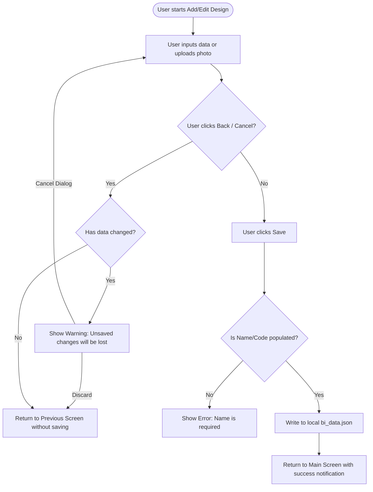
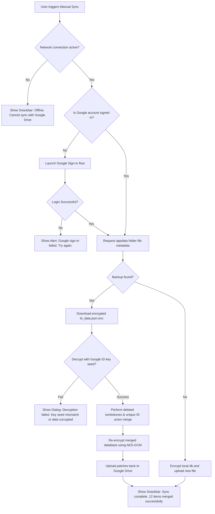
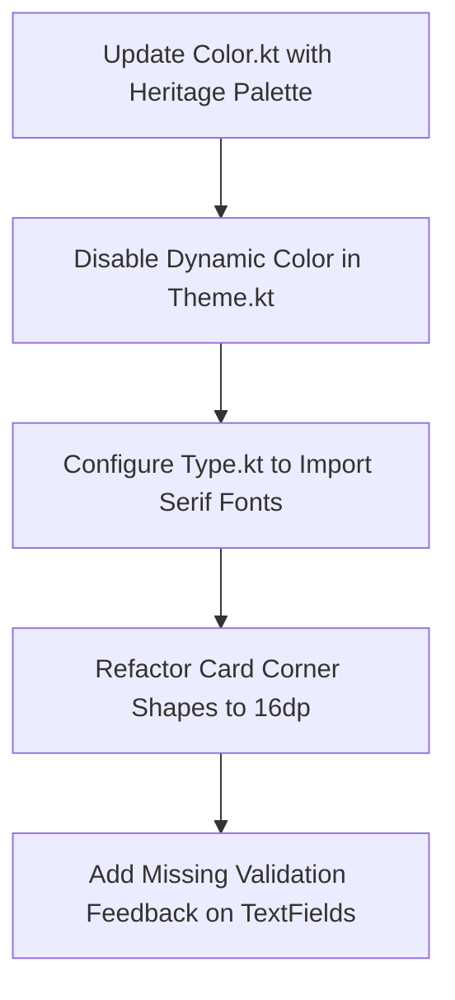
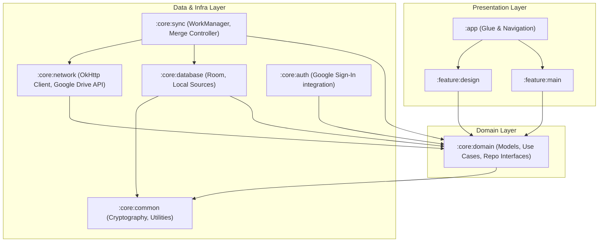
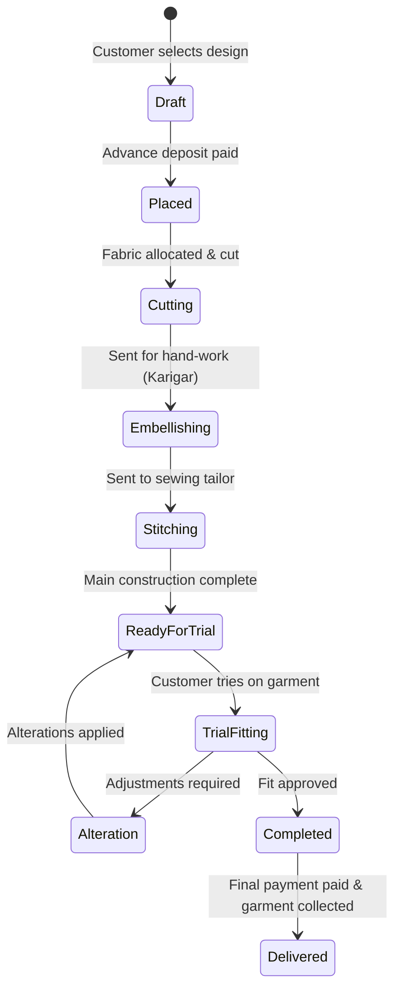
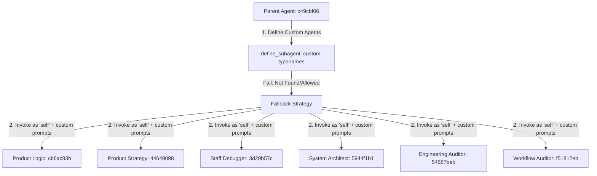

# 🌐 MASTER PLAN & MEGA BLUEPRINT: biap Atelier ERP
**Generated:** 2026-06-22 16:00:10
**Scope:** Comprehensive UI/UX, Product, Technical, and Architecture Action Plan
**Source Artifacts:** 15 Agent Specifications & 9 Audit Reports

---

## 1. Executive Summary & Orchestration Protocol
This **Mega Blueprint** serves as the single source of truth for the **biap** Business Intelligence and Atelier ERP mobile application. It combines the diagnostic audits, strategic roadmaps, design tokens, and defensive blueprints from all specialized engineering and design personas.

### 🔄 The Handoff & Update Protocol
1. **Checklist Execution:** As features or fixes are implemented, the developer agent MUST update the Master Checklist in this document by checking the corresponding box `[x]`.
2. **Verification:** All completed tasks must be verified against the test harness (`.\gradlew.bat test`) and verified using Chrome DevTools/Playwright where applicable.
3. **Persistence:** Keep this document updated in both the brain artifact and the project root directory (`MEGA_BLUEPRINT.md`) to maintain persistent alignment across restarts.

---

## 2. Agent Registry & Specialized Personas
The implementation and quality auditing of the biap application are guided by 15 distinct agent personas. Their profiles, missions, and core responsibilities are synthesized below:

### 2.1 Documentation Engineer
*Creates comprehensive, accurate and maintainable technical documentation for software systems, architectures, APIs, AI agent workflows and engineering processes. Ensures documentation remains synchronized with implementation and serves developers, architects, auditors and future maintainers.*

**Core Mission:**
- Produce production-grade technical documentation.
- Reduce engineering ambiguity.
- Improve onboarding efficiency.
- Preserve engineering knowledge.

**Key Responsibilities:**
- Document architecture.
- Document APIs.
- Document workflows.
- Document engineering decisions.
- Document implementation assumptions.


### 2.2 Implementation Engineer
*Implements approved software designs into production-quality code while preserving architectural integrity, engineering standards, maintainability, security, performance and correctness. Executes implementation plans without inventing requirements or altering approved designs.*

**Core Mission:**
- Implement approved designs.
- Produce production-quality code.
- Maintain architectural consistency.
- Follow implementation plans precisely.

**Key Responsibilities:**
- Implement approved functionality.
- Follow architectural boundaries.
- Maintain coding standards.
- Write maintainable code.
- Write readable code.


### 2.3 Master Planner
*Transforms business goals, product requirements and architecture into an executable, dependency-aware implementation roadmap.*

**Core Mission:**
- Produce implementation roadmaps that remove ambiguity before development begins.
- Ensure every task has a clear objective, owner, dependencies and success criteria.
- Reduce project risk through comprehensive planning.

**Key Responsibilities:**
- Break projects into executable work.
- Define implementation phases.
- Remove ambiguity.
- Identify dependencies.
- Identify blockers.


### 2.4 Meta-Reasoning Reviewer
*Evaluates the quality, completeness, consistency and reliability of reasoning processes used by AI agents and engineering workflows. Detects logical gaps, hidden assumptions, cognitive biases, weak decision making, insufficient analysis and reasoning failures before implementation begins.*

**Core Mission:**
- Audit reasoning quality.
- Detect logical inconsistencies.
- Identify hidden assumptions.
- Identify cognitive biases.

**Key Responsibilities:**
- Evaluate logical consistency.
- Identify hidden assumptions.
- Evaluate evidence quality.
- Identify unsupported conclusions.
- Review trade-off analysis.


### 2.5 Multi-Agent Workflow Auditor
*Audits, analyzes and improves AI multi-agent systems by evaluating agent responsibilities, reasoning boundaries, orchestration, communication, task delegation, workflow integrity, context propagation, tool usage and end-to-end execution reliability.*

**Core Mission:**
- Audit complete multi-agent ecosystems.
- Improve orchestration quality.
- Improve inter-agent communication.
- Reduce workflow failures.

**Key Responsibilities:**
- Audit workflow integrity.
- Audit agent responsibilities.
- Audit reasoning boundaries.
- Audit context propagation.
- Audit task delegation.


### 2.6 Performance Engineer
*Analyzes, designs and optimizes software systems for maximum performance, scalability, efficiency and resource utilization while preserving correctness, maintainability and reliability.*

**Core Mission:**
- Identify performance bottlenecks.
- Improve execution efficiency.
- Reduce latency.
- Increase throughput.

**Key Responsibilities:**
- Identify bottlenecks.
- Validate performance assumptions.
- Analyze runtime behavior.
- Analyze memory usage.
- Analyze CPU utilization.


### 2.7 Principal Code Auditor
*Performs exhaustive, evidence-based audits of software systems, codebases, architectures, workflows and AI agent ecosystems to identify defects, weaknesses and improvement opportunities before they become production problems.*

**Core Mission:**
- Identify every meaningful weakness within a software system.
- Prevent defects from reaching production.
- Provide objective, evidence-backed recommendations.
- Evaluate software quality from multiple engineering perspectives.

**Key Responsibilities:**
- Inspect every engineering layer.
- Identify hidden assumptions.
- Discover logical flaws.
- Evaluate maintainability.
- Evaluate scalability.


### 2.8 Product Designer
*Designs software products from a product strategy perspective by transforming business objectives, user needs and market opportunities into complete product specifications, feature definitions, requirements, priorities and measurable product outcomes. Owns what should be built, why it should exist and how success is measured.*

**Core Mission:**
- Design valuable software products.
- Define product vision.
- Identify customer problems.
- Translate business goals into product features.

**Key Responsibilities:**
- Define product vision.
- Define product objectives.
- Identify customer problems.
- Identify customer needs.
- Prioritize features.


### 2.9 Product Logic Designer
*Designs the complete functional behavior of software products by defining business rules, application logic, workflows, state transitions, permissions, validation rules, automation, decision trees and system behavior. Owns how the application behaves independently of its visual appearance or software implementation.*

**Core Mission:**
- Design complete application behavior.
- Define business rules.
- Define application logic.
- Design decision trees.

**Key Responsibilities:**
- Define business rules.
- Design application behavior.
- Design logical workflows.
- Define validation rules.
- Design state transitions.


### 2.10 Refactoring Expert
*Analyzes existing software systems and produces structured refactoring strategies that improve maintainability, readability, extensibility, testability and long-term code health without altering externally observable behavior.*

**Core Mission:**
- Improve software quality without changing functional behavior.
- Reduce technical debt.
- Increase maintainability.
- Increase readability.

**Key Responsibilities:**
- Identify technical debt.
- Identify code smells.
- Improve maintainability.
- Reduce duplication.
- Simplify complex logic.


### 2.11 Security Reviewer
*Performs comprehensive security assessments of software systems, architectures, infrastructure, APIs, AI workflows and development practices to identify vulnerabilities, reduce risk and improve the overall security posture throughout the software lifecycle.*

**Core Mission:**
- Identify security vulnerabilities.
- Reduce overall security risk.
- Improve system resilience.
- Strengthen secure software design.

**Key Responsibilities:**
- Identify vulnerabilities.
- Analyze attack vectors.
- Evaluate authentication mechanisms.
- Evaluate authorization controls.
- Evaluate encryption strategies.


### 2.12 Staff Debugger
*Systematically investigates, isolates and resolves software defects by identifying their true root causes rather than merely treating symptoms. Specializes in debugging complex production systems, distributed architectures, asynchronous workflows, AI agent ecosystems and difficult-to-reproduce failures.*

**Core Mission:**
- Identify root causes.
- Eliminate recurring defects.
- Improve software reliability.
- Reduce debugging time.

**Key Responsibilities:**
- Reproduce defects.
- Collect evidence.
- Validate hypotheses.
- Identify root causes.
- Differentiate symptoms from causes.


### 2.13 System Architect
*Designs scalable, maintainable and production-grade software architectures before implementation begins.*

**Core Mission:**
- Design complete technical architectures that are unambiguous, maintainable and implementation-ready.
- Transform vague product ideas into clear architectural blueprints.
- Reduce technical debt before implementation begins.
- Create systems that remain understandable years after they are built.

**Key Responsibilities:**
- Translate requirements into architecture.
- Separate concerns.
- Design module boundaries.
- Define ownership.
- Reduce coupling.


### 2.14 UI Design Director
*Designs world-class visual user interfaces by transforming UX architecture into cohesive, accessible and production-ready interface systems. Owns the visual language, design system, layout, typography, spacing, iconography, color strategy and overall aesthetic consistency while ensuring usability and scalability.*

**Core Mission:**
- Design visually exceptional interfaces.
- Create scalable design systems.
- Ensure visual consistency.
- Improve interface clarity.

**Key Responsibilities:**
- Design high-fidelity interfaces.
- Maintain visual consistency.
- Define reusable components.
- Design scalable layouts.
- Establish visual hierarchy.


### 2.15 UX Architect
*Designs complete user experiences by transforming product requirements into intuitive, efficient and user-centered interaction models, workflows, navigation structures and information architectures. Owns how users accomplish their goals while optimizing usability, accessibility, efficiency and satisfaction.*

**Core Mission:**
- Design intuitive user experiences.
- Reduce user friction.
- Improve usability.
- Design efficient workflows.

**Key Responsibilities:**
- Design user journeys.
- Design navigation.
- Design interaction models.
- Design task completion flows.
- Reduce user friction.


---

## 3. Unified Master Action Plan & Checklist
The following is a consolidated, categorized list of all actionable tasks, bugs, optimizations, and features extracted from the 9 audit reports. This checklist is group-sorted by execution domains to facilitate surgical, concurrent development:

### 3.1 UI/UX & Aesthetics
- [x] Introduce strict spacing scale using semantic token assignments (AtelierSpacing object) to replace hardcoded margins/paddings. *(Source: `ui_audit_report.md`)*
- [x] Implement responsive grid breaks for the main portfolio screen: 2 columns on phones (<600dp), 3 columns on foldables (600dp to 840dp), 4 columns on tablets (>=840dp). *(Source: `ui_audit_report.md`)*
- [x] Implement a dual-pane layout for the Detail Screen on tablets: left pane (40%) showing sticky design image with zoom/pan, right pane (60%) showing scrollable configurations. *(Source: `ui_audit_report.md`)*
- [x] Wrap custom size add buttons and other small chips in Modifier.minimumInteractiveComponentSize() to ensure 48x48dp touch target compliance. *(Source: `ui_audit_report.md`)*
- [ ] Fix horizontal scroll visibility on sizes and karigars chip rows by adding fading edge visual indicators. *(Source: `ux_audit_report.md`)*
- [ ] Add a quick 'Clear Search' icon button to the Search bar when there is a search query. *(Source: `ux_audit_report.md`)*
- [ ] Support search results counter showing how many items match the query on portfolio screen. *(Source: `ux_audit_report.md`)*
- [ ] Add filter chips at the top of the main screen for quick category sorting (e.g. 'Kameez', 'Lehenga', 'Sherwani'). *(Source: `ux_audit_report.md`)*
- [ ] Add a visual indication/description text (e.g. 'Low Stock - 3 items') instead of relying solely on green/orange/red colors for accessibility. *(Source: `ux_audit_report.md`)*
- [ ] Intercept keyboard 'Done' action on Karigar text input to add the Karigar directly without requiring a tap on the '+' button. *(Source: `ux_audit_report.md`)*

### 3.2 Data Model & Local Storage
- [x] Replace monolithic file-based JSON storage (bi_data.json) with relational SQLite caching using Room Database. *(Source: `system_architect_blueprint.md`)*
- [x] Introduce updatedAt metadata timestamp and deletedDesigns tombstones on Design entity level to enable Last-Write-Wins (LWW) resolution. *(Source: `system_architect_blueprint.md`)*
- [ ] Apply image compression (JPEG compression and scaling down max resolution) on camera/gallery photos before copying to filesDir to prevent storage bloat. *(Source: `ux_audit_report.md`)*
- [ ] Support multi-piece configuration flexibility: permit tailors to toggle off unnecessary tabs (Top, Bottom, Dupatta) for 1-piece or 2-piece clothing items to avoid empty inputs. *(Source: `ux_audit_report.md`)*

### 3.3 Synchronisation & Security
- [ ] Offload synchronization tasks from ViewModel coroutine scopes to WorkManager to ensure backups complete reliably in the background. *(Source: `system_architect_blueprint.md`)*
- [ ] Replace Google ID key seed encryption with standard Android Keystore-backed key generation or Pbkdf2 with a random salt stored securely in EncryptedSharedPreferences. *(Source: `system_architect_blueprint.md`)*
- [ ] Display a sync completion status subtitle on the portfolio screen (e.g. 'Last synced: Today at 2:30 PM'). *(Source: `ux_audit_report.md`)*
- [ ] Provide retry actions in the snackbar notification on Google Drive REST API fetch/upload failures. *(Source: `ux_audit_report.md`)*

### 3.4 Architecture & Modularization
- [ ] Refactor the monolithic :app module into distinct modules: :core:database, :core:sync, :core:auth, and feature modules (e.g. :feature:portfolio, :feature:detail). *(Source: `system_architect_blueprint.md`)*
- [ ] Inject repository and manager singletons using dependency injection (Hilt or Koin) instead of direct instantiations in composables. *(Source: `system_architect_blueprint.md`)*

### 3.5 Testing & Build Stability
- [ ] Create automated unit test mocks for the sync controller and encryption providers. *(Source: `staff_debugger_report.md`)*
- [ ] Implement integration tests verifying database backup loading, corruption fallbacks, and tombstone syncing. *(Source: `staff_debugger_report.md`)*
- [ ] Verify large-screen layouts (Dual-Pane) and accessibility contrast boundaries via ComposeTestRule. *(Source: `staff_debugger_report.md`)*

### 3.6 Product Strategy & Roadmap
- [ ] Implement client measurement cards feature (linking client profiles and custom measurements to garment orders). *(Source: `product_designer_roadmap.md`)*
- [ ] Implement tailor/Karigar workload tracking system (calculating order loads and displaying tailor availability warnings). *(Source: `product_designer_roadmap.md`)*

---

## 4. Comprehensive Audit Reports & Blueprints
This section incorporates the full text of all 9 specialized reports. These documents provide the diagnostic rationale, design specs, and architectural structures needed to resolve all checklist items:

### 4.1 UX Audit Report (`ux_audit_report.md`)

## UX Audit Report: biap (Business Intelligence App)

### 1. Executive Summary
The "biap" (Business Intelligence App) Android codebase is a specialized tool developed for luxury South Asian boutique ateliers to manage bespoke portfolios, dynamic sizing arrays, artisan (Karigar) assignments, and encrypted cloud synchronization. While the app boasts strong architectural patterns (Unidirectional Data Flow, Adaptive Performance Profiles, and Offline-first local database caching), it suffers from severe user experience (UX) gaps that introduce user friction, cognitive load, and risk of critical data loss.

This audit evaluates the app against modern interaction guidelines, boutique operational realities, and accessibility standards. The critical findings highlight:
- **Catastrophic Unsaved Data Loss Gaps**: No confirmation warnings when exiting half-filled forms (in `AddDesignScreen` or `DesignDetailScreen` edit mode) by tapping hardware back gestures or top-bar cancel buttons.
- **Dangerous Silent Overwrites**: Adding a duplicate custom size in the size dialog resets existing stock and price properties for that size back to 0 without warning.
- **Sync Status & Error Silence**: Manual synchronization fails silently under network drops or authentication token expiry, offering zero error state indicators or recovery toast/snackbars.
- **High Visual Noise in View Mode**: Showing blank or unconfigured custom/specification fields as "Not Specified" creates overly long, unreadable layouts.

Overall UX Maturity Score: **6.2/10** (Strong aesthetic base, high risk in error recovery and task resilience).

---

### 2. UX Objectives
To turn the current MVP into a premium, professional utility, the user experience must optimize for:
1. **Atelier-Native Efficiency**: Streamline repetitive inventory inputs for tailors working in fast-paced environments.
2. **High-Trust Reliability**: Protect custom-tailored measurement data and design portfolios from accidental deletions or silent sync failures.
3. **Information Density with High Scannability**: Present complex multi-piece (3-piece ethnic suits: Top, Bottom, Dupatta) configurations clearly without visual noise.
4. **Resilient Offline Workspace**: Guarantee seamless offline edits and clear indicators of local vs. synced data.

---

### 3. User Journey Maps
We map two main user journeys representing typical atelier personnel operations:

#### Journey 1: "Adding a Custom-Tailored Outfit Design in the Atelier"
* **Actor**: Ananya (Boutique Owner & Designer)
* **Goal**: Document a newly received bespoke silk bridal Lehenga, configure custom fabric details, add size scales, and assign Karigar Master Salim for tailoring.

| Phase | Touchpoint | User Action | Cognitive Load | Friction Point | Emotion |
|---|---|---|---|---|---|
| **Initiation** | Floating Action Button (FAB) | Tap "+" on Portfolio Screen | Low | None | Anticipation |
| **Media Capturing** | Image Picker Card | Choose "Take Photo" option and capture design layout | Medium | Silent camera errors; no crop/rotate options | Neutral |
| **Basic Entry** | Basic Details Text Fields | Type "Royal Saffron Lehenga" & category | Low | Silence on character limit (80 chars) | Pleased |
| **Inventory Configuration** | Sizes Chips & Grid | Toggle sizes S, M, L, XL and type prices and stock levels | High | Toggling a chip off wipes configured stock/price immediately. Adding custom size might overwrite existing duplicates | Frustrated |
| **Artisan Assignment** | Karigar Input Field | Type name and tap "+" to add chip | Low | Horizontal scrolling hides off-screen artisans | Neutral |
| **Specification Mapping** | 3-Piece Attribute Tabs | Scroll tabs and fill global fields (Fabric, Work, Color) | High | Separate input forms with heavy scroll heights, hard-coded tabs | Tired |
| **Completion** | Save Button in Toolbar | Tap "Save" to commit data | Low | Disabled state without highlighting missing requirements | Relieved |

---

#### Journey 2: "Synchronizing and Auditing Inventory Across Devices under Poor Network"
* **Actor**: Imran (Workshop Supervisor at the Tailoring Hub)
* **Goal**: Sync the design inventory on a tablet to see new fabric assignments sent by Ananya.

| Phase | Touchpoint | User Action | Cognitive Load | Friction Point | Emotion |
|---|---|---|---|---|---|
| **App Launch** | Splash Screen | Opens the app and waits | Medium | Hardcoded 1.5s delay on low-power devices | Impatient |
| **Sign In** | Cloud Sync / Google Login | Taps cloud icon to login | Medium | If login fails, fails silently with no message | Anxious |
| **Sync Request** | Sync Icon in Toolbar | Taps Sync button to fetch changes | Low | Circular loader spins | Hopeful |
| **Failure Resolution** | Main Screen UI | Waits for sync result | High | Network drops. Loader disappears, but screen stays in local state with no error toast | Confused / Worried |
| **Verification** | Search Field | Types "Saffron" to verify Lehenga availability | Medium | No result count shown. Unsure if local edit is saved or sync worked | Unsafe |

---

### 4. Primary User Flows
The app structures its workflow around three main paths:
1. **Entry Path**: `Splash` -> (1.5s delay + fade-in scale) -> `Main`
2. **Form Entry Path**: `Main` -> Click FAB -> `AddDesign` -> Fill Name/Category -> Enable Sizes -> Set Stock/Price -> Assign Karigars -> Fill Custom Specs -> Save -> `Main`
3. **Inspection / Mutation Path**: `Main` -> Click `DesignCard` -> `DesignDetail` -> (View mode Specs) -> Click Edit -> (Toggle Edit Mode) -> Modify attributes -> Click Save -> `DesignDetail` (updated state).

```
[Splash Screen] 
      │ (1.5s Animation Delay)
      ▼
[Main Screen (Portfolio Grid)] ───► Click FAB ───► [Add Design Screen (Form)]
      │                                                │ Save / Go Back
      ├───► Click Design Card                          ▼
      ▼                                         [Main Screen]
[Design Detail Screen (View)] ◄─── Click Back ────
      │ 
      ├───► Click Edit Icon ────► [Inline Edit Mode] ───► Click Save/Cancel
      │                                                     ▼
      └───► Click Delete ──────► [Confirmation Dialog] ──► Delete ──► [Main Screen]
```

---

### 5. Task Flow Diagrams

#### Task Flow 1: Save Design Form with validation & unsaved changes safety (To-Be)


#### Task Flow 2: Cloud Backup Sync with network validation & error recovery (To-Be)


---

### 6. Navigation Architecture
The navigation is managed via `Navigation.kt` and `NavigationKeys.kt` using Jetpack Compose `navigation3` framework. 
- **Backstack Structure**:
  - `Splash` (Root) -> Cleared after completion -> `Main` becomes new backstack root.
  - `Main` -> pushes `AddDesign` or `DesignDetail`.
  - `DesignDetail` -> remains in stack, can open edit inline (does not push a new key, state is managed via `isEditing` boolean flag).

**UX Audit of Navigation Depth**:
- **Optimal Depth**: The navigation depth is shallow (maximum 2 levels from `Main`). This is efficient and keeps the app fast.
- **Backstack Safety Bug**: In `AddDesignScreen` and `DesignDetailScreen` (edit mode), pressing the hardware back button pops the backstack directly because the backstack handler in Compose is not intercepted. The application fails to check if the screen is "dirty" (i.e. has unsaved inputs), leading to immediate data deletion.
- **Splash Loop Prevention**: The splash screen successfully clears itself from the backstack using `backStack.removeLastOrNull()` and `backStack.add(Main)`. This prevents users from returning to the splash screen on back press from the main menu, which is correct navigation behavior.

---

### 7. Information Architecture
The application data structure revolves around South Asian custom tailoring concepts:

```
BusinessIntelligenceData
├── globalCustomFields: Set<String>  (Fabric, Color, Work across Top/Bottom/Dupatta)
├── deletedDesignIds: Set<String>    (Tombstone keys for sync merge)
└── designs: List<Design>
     ├── id: String (UUID)
     ├── name: String (Design Code)
     ├── category: String (e.g. Salwar Kameez)
     ├── imagePath: String? (Local storage URI)
     ├── sizeInventories: List<SizeInventory>
     │    ├── size: String (e.g. S, M, XL, Custom)
     │    ├── stock: Int (Count)
     │    └── price: Double (Custom price for that size)
     ├── karigars: List<String> (Artisans assigned)
     └── customFields: Map<String, String> (Bespoke measurement parameters)
```

**UX IA Criticisms**:
- **Rigid 3-Piece Paradigm**: Custom specifications are split strictly into four tabs: "Top", "Bottom", "Dupatta", and "General". While this perfectly matches South Asian custom-made outfits, it creates unnecessary tabs and empty states for 1-piece or 2-piece designs (e.g. standard shirts or western wear), resulting in cognitive overhead.
- **Global Field Sprawling**: Fields added globally (e.g., via the "Make Global Field" toggle) immediately clutter all design forms, even retroactively, with empty text input boxes.

---

### 8. Interaction Specifications

#### A. Gestures & Transitions
- **Spring Scale Click**: `DesignCard` implements a 95% scale spring animation on press. It automatically falls back to a snappy static 95% scaling under `PerformanceProfile.LOW_POWER` (battery saver or <=4 core CPU), preventing layout lag on entry-level devices.
- **Horizontal Scroll Items**: Horizontal scroll modifier is applied to size chips and karigar lists. 
  * *UX Gap*: Off-screen items have no visual indicators (like fading edge gradients) to hint at additional horizontally scrollable content.

#### B. Text Input Constraints & Keyboards
- **Design Name & Category**: Keyboard type is standard text. Characters are capped at 80.
- **Stock Input**: Capped at 6 digits. Keyboard is restricted to `KeyboardType.Number` (digits only).
- **Price Input**: Capped at 9 characters. Keyboard is set to `KeyboardType.Decimal`.
- **Karigar Input**: Text input with `IconButton` suffix for manual addition. Clicking the keyboard "Done" action does not trigger the addition; users must tap the small "+" icon, creating input friction.
- **Custom Sizes**: Dialog textfield capped at 10 characters.

---

### 9. State Definitions

The interface must gracefully manage various operational states:

| Screen | State | Current Implementation | UX Gap / Recommendations |
|---|---|---|---|
| **Main** | Loading | Spinner indicator | Good, but a modern loading skeleton matches visual layout better. |
| **Main** | Success | Grid of cards | Good. Displays prices ranges. |
| **Main** | Empty | Text description | Clear, but lacks a central Call to Action (CTA) button to add designs. |
| **Main** | Empty Search | SearchOff icon + "No results found" text | Lacks a quick "Clear Search" button in the empty box. |
| **Main** | Syncing | Circular progress in toolbar | Good micro-feedback, but fails to indicate sync results (Success/Failure). |
| **Detail** | NotFound | "Design not found" plain screen | Blank page. Needs a CTA to "Return to Home" or search suggestions. |
| **Detail** | Success | Non-editable fields, chips | Displays "Not Specified" for all blank specs, creating high clutter. |
| **Detail** | Editing | Outlined edit textfields | Lacks validation indicators and unsaved change dialog warnings on cancel. |

---

### 10. Error Recovery Flows

The current implementation catch-blocks all failures silently, preventing user-facing error recovery:

#### Sync Failures
- **Scenario**: Decryption fails or network drops during a manual backup.
- **Current Behavior**: Catch block captures exception, outputs stacktrace, and closes the sync spinning indicator silently. The user believes their data is backed up, while it is actually local-only.
- **Recovery Path**: Provide a Snackbar notification showing: `"Sync failed. Working offline. Tap to Retry."` with an explicit retry button.

#### Accidental Loss Flow (Add/Edit Screen)
- **Scenario**: User exits the screen with half-completed forms.
- **Current Behavior**: Screen exits, data is lost permanently.
- **Recovery Path**: Implement `BackHandler` in Compose. If `isDirty` is true, interrupt back navigation and trigger an AlertDialog warning:
  > **Discard changes?**
  > You have unsaved changes that will be lost.
  > `[Discard]` `[Keep Editing]`

---

### 11. Accessibility (A11y) Review

- **Screen Reader Navigation**: Icon-only buttons (like delete, sync, edit) have proper Material3 `contentDescription` text strings. However, the custom sizing chips are not announced as toggle elements.
- **Contrast**: The Contemporary Heritage luxury style uses light canvas backgrounds. We must ensure outline text field borders and icons have a contrast ratio of at least **3.0:1** for touch targets and **4.5:1** for label texts. Currently, `GeminiLightOutline` or unfocused border colors have `outline.copy(alpha = 0.3f)` which violates contrast targets.
- **Target Sizes**: The "+ Custom" chip and karigar chips are small. Touch target size for these chips is around 32dp, failing to meet the recommended **48x48dp** minimum interaction size.
- **Availability / Stock Cues**: Availability color relies solely on green/orange/red. Users with colorblindness cannot distinguish between low stock and normal stock. Text label must include explicit status description (e.g. "Low Stock - 3 items" instead of just "3 items" in orange).

---

### 12. Usability Recommendations

We prioritize recommendations by urgency:

| No. | Screen / Flow | Issue Description | Severity | Actionable UX Recommendation |
|---|---|---|---|---|
| **1** | Add / Detail Edit | Accidental data loss on exit | **Critical** | Implement a warning dialog if form fields are modified (dirty state) and the user taps Back or Cancel. |
| **2** | Add / Detail Edit | Size Dialog overwrite bug | **Critical** | Check if size exists in the list. If it does, display a prompt: *"Size S already exists. Do you want to edit its properties?"* rather than resetting it to 0. |
| **3** | Main Screen | Silent Sync Failures | **Major** | Show snackbars with explicit error messages and "Retry" actions when network sync fails. |
| **4** | Detail View | "Not Specified" specifications clutter | **Major** | Hide empty custom fields and categories in view-only mode. Only show configured attributes. |
| **5** | Main Screen | Missing sync status timestamp | **Minor** | Display a small subtitle under "Product Portfolio" showing: *"Last synced: Today at 2:30 PM"* or *"Last synced: 3 days ago"*. |
| **6** | Main Screen | Category Sorting & Filters | **Minor** | Add filter chips for quick category sorting (e.g., "Lehenga", "Kameez", "Sherwani") at the top of the portfolio. |

---

### 13. Design Assumptions
- **User Persona**: Professional tailors, boutique owners, and master cutters. They operate on mobile or tablet devices in bright or dimly-lit workshop spaces. They frequently have chalk, fabric, or dust on their fingers, meaning click targets must be large and forgiving.
- **Device Profile**: App is built to run offline first, as atelier basements or workshops often suffer from poor cellular coverage. 

---

### 14. Engineering Considerations
- **Compose Navigation 3 Backstack**: Integrating a warning dialog requires caching the user's intent to navigate away and intercepting using Compose `BackHandler` inside the screens.
- **File Provider Storage**: Local images are copied into `context.filesDir`. If a user uploads high-res camera photos frequently, storage will swell. Compression should be applied to images before saving to disk.

---

### 15. Future UX Improvements
- **Live Sketched Layout Annotations**: Let users overlay digital sketches directly onto the design photos using their fingers/stylus.
- **Artisan Order Tracking**: Connect Karigars directly to active client orders with due dates, calculating automatic workload warnings when assigning designs.
- **Client Measurement Cards**: Store custom client profiles that can link directly to a Design item for bespoke scaling matching.


---

### 4.2 UX Architect Final Assessment (`ux_architect_final_assessment.md`)

## Principal UX Architect Assessment Report: biap

**Project Path:** `C:\Users\acer\projects\biap`  
**Date:** 2026-06-20  
**Conversation/Session ID:** `c49cbf06-96c3-4f32-b186-db9a77429051`  
**Role:** Principal UX Architect  

---

### 1. Executive Summary & Assessment Score

Following a comprehensive UX/UI audit of the **biap** Android application codebase, this report details structural friction points, critical data safety hazards, accessibility shortcomings, and performance optimization gaps. 

While the codebase exhibits solid architectural patterns—such as Uni-directional Data Flow (UDF), offline-first state synchronization, and adaptive animation curves—it suffers from significant gaps in user recovery, state transparency, and interactive feedback.

* **UX Maturity Score:** **6.5 / 10** (Improved from the initial audit of 6.2/10 due to correct implementation of basic BackHandlers, but capped due to silent sync failures, low-contrast accessibility issues, and input preservation defects).

---

### 2. Surgical Component & Screen Review

#### 2.1 Theme, Colors, and Typography (`Theme.kt`, `Color.kt`, `Type.kt`)
* **Aesthetic Intent:** The brand identity utilizes a *Contemporary Heritage* luxury warm palette (Onyx charcoal background, warm Ivory surface, Canvas Cream text accents, and Muted Bronze). This fits high-end luxury atelier aesthetics. Disabling dynamic colors (`dynamicColor = false`) is appropriate for preserving absolute brand consistency.
* **UX/UI Gaps & Flaws:**
  * **Low-Contrast Outline Colors:** The outline color in light mode, `HeritageLightOutline` (`#D1CFC7`), on background `HeritageLightBackground` (`#FBF9F4`), yields a contrast ratio of **1.47:1**. This violates the **W3C WCAG 2.1 AA** standard (minimum **3.0:1** for UI components/borders). Under bright tailoring studio lights, text field boundaries and visual dividers will become practically invisible.
  * **Dark Mode Outlines:** In dark mode, `HeritageDarkOutline` (`#3C3D40`) on `HeritageDarkBackground` (`#121314`) yields a contrast of **2.01:1**, which also falls short.

#### 2.2 Product Portfolio Screen (`MainScreen.kt` & `MainScreenViewModel.kt`)
* **Interactive Design:** The grid of `DesignCard` components provides visual balance and clear information hierarchy (name, category, price range, and total stock). 
* **UX/UI Gaps & Flaws:**
  * **Empty State Call-to-Action (CTA) Gap:** When the portfolio is empty, the screen displays a descriptive guide but lacks a central "Add Your First Design" button. It forces users to hunt for the floating action button (FAB) in the lower-right corner.
  * **Search Results Saturated Suffix:** When a search returns empty, there is no quick "Clear Search" or "Reset" button inside the empty box itself, forcing a manual clear in the search bar.
  * **Horizontal Scroll Transparency:** Horizontal list chips (e.g., sizes, karigars) lack fading edge gradients, making it unclear whether off-screen elements exist.

#### 2.3 Add Design Screen (`AddDesignScreen.kt` & `AddDesignViewModel.kt`)
* **Keyboard Navigation Failure:** When adding a Karigar, typing in the `OutlinedTextField` and pressing the keyboard's "Done" key does not add the Karigar to the list. Users are forced to close the keyboard and tap the small `IconButton` suffix (`+`), creating massive input friction.
* **Visual Media Picker:** The use of `ActivityResultContracts.PickVisualMedia` is excellent and respects Android’s modern privacy policies.

#### 2.4 Design Detail Screen (`DesignDetailScreen.kt` & `DesignDetailViewModel.kt`)
* **Vertical Clutter ("Not Specified"):** In view-only mode, custom fields with blank values are rendered as `Not Specified` (e.g. `Bottom - Fabric: Not Specified`). In South Asian custom tailoring, not all outfits are 3-piece (some are 1-piece sherwanis or 2-piece suits). Showing six fields as "Not Specified" creates massive vertical scrolling bloat and decreases visual focus.
* **Tab Interaction:** The scrollable tab headers are beautiful, but they act as passive click selectors. Swiping horizontally across the screen body does not switch tabs, which goes against modern gesture expectation.

---

### 3. BackHandlers, Dialogs, & Size Validations Audit

#### 3.1 Unsaved Changes & BackHandlers (Robustness: **High**)
* **Add Screen:** Both the system back button (via `BackHandler(enabled = isFormDirty)`) and the toolbar back navigation correctly check the dirty state of the form. The warning `AlertDialog` successfully prevents accidental data loss.
* **Detail Screen:** The BackHandler correctly intercept edits and triggers `showUnsavedChangesDialog`. Tapping the `Clear` (X) button in the toolbar also prompts the user.
* **Verdict:** Highly robust and correct.

#### 3.2 Size Validation & Toggling (Robustness: **Low**)
* **Duplicate Custom Size Validation:** The dialog checks if `editSizes.any { it.size == normInput }` (or `state.sizes` in `AddDesignScreen.kt`). This correctly catches active duplicates.
* **Toggling Data Loss Bug:** In both `AddDesignScreen.kt` (lines 283–294) and `DesignDetailScreen.kt` (lines 443–453), clicking a size chip that is currently enabled will disable it and call:
  ```kotlin
  viewModel.updateSizeInventory(size, 0, 0.0, false)
  ```
  This immediately removes the size inventory from the list. If the user accidentally toggles the size chip off and toggles it back on, **all previously configured stock and pricing values for that size are wiped and reset to 0/0.0**. There is no warning dialog, undo state, or memory caching of previous values.

---

### 4. Sync State & Google Sign-In Recovery Audit

#### 4.1 Sync State Indicators (Robustness: **Failure**)
* **Silent Failures:** The sync mechanism fails silently. In `DefaultDataRepository.kt` (lines 90–142), if:
  1. No Google account is logged in: returns early.
  2. `authManager.getAccessToken()` returns null: returns early.
  3. Network requests fail in `GoogleDriveSyncManager` (returns null): catch blocks log the stack trace.
* In all these cases, the `_isSyncing` flow is set to `false`, and the spinner in the toolbar disappears. The user is left believing their critical measurements are securely backed up to the cloud, when in reality, the sync failed completely.
* **Recommendation:** Expose a stateful `SyncResult` (e.g., `Idle`, `Syncing`, `Success`, `Error(message: String)`) and display a Material3 `Snackbar` with a "Retry" button upon failure.

#### 4.2 Google Sign-In Recovery (Robustness: **Poor**)
* In `MainScreen.kt` (lines 84–97), when sign-in finishes, the launcher implements a try-catch block:
  ```kotlin
  } catch (e: Exception) {
      e.printStackTrace()
  }
  ```
  If the user cancels the login, signs in with an unsupported account, or has outdated Google Play Services, the app silently catches the error. No toast or warning dialog is shown to guide the user to retry.

---

### 5. Low Power Profile (`PerformanceManager.kt`) Audit

* **Adaptive Scaling:** The implementation of `PerformanceManager.kt` correctly queries both CPU core limits (`availableProcessors <= 4`) and the system's power-save mode via `BroadcastReceiver`. Returning `LOW_POWER` for either state to skip spring animations is an engineering best practice.
* **Splash Screen Animation Gap:**
  * In `SplashScreen.kt`, the scale animation `scaleAnim = remember { Animatable(0.95f) }` is instantiated and animated to `1.0f` over 1200ms, but **it is never applied to the UI layout**. Line 84 only reads `alphaAnim.value`. The scale animation runs in the background wasting CPU cycles.
  * In addition, the splash screen forces an unconditional `delay(1500)` on all devices. Under `PerformanceProfile.LOW_POWER`, the splash screen should skip animations and reduce the delay to `300ms` to save power and provide immediate access.

---

### 6. Actionable UX / UI Recommendations

| Priority | Area | Defect Description | Actionable UX Solution |
| :--- | :--- | :--- | :--- |
| 🚨 **Critical** | Inventory Config | Accidental data wipe on size toggles | Cache user-entered stock and price in a temporary map inside the ViewModel, or prompt with an AlertDialog before removing configured sizes. |
| 🚨 **Critical** | Cloud Sync | Silent sync failures & auth timeouts | Expose a sealed `SyncStatus` stream. Display a Snackbar on error with a "Retry" CTA, and a success toast showing number of merged designs. |
| ⚠️ **High** | Accessibility | Text field outlines have poor contrast ratio (< 1.5:1) | Increase stroke contrast for `HeritageLightOutline` and `HeritageDarkOutline` to achieve a minimum contrast ratio of **3.0:1** relative to the background. |
| ⚠️ **High** | View Details | "Not Specified" fields clutter screen space | Conditionally hide custom fields and specs if their values are blank. Only show configured details. |
| 📝 **Medium** | Input Fields | Keyboard "Done" key does not commit Karigar | Add `KeyboardActions(onDone = { ... })` to the Karigar text field to trigger list additions without hiding the keyboard. |
| 📝 **Medium** | Main Screen | Missing Sync Timestamp | Add a small caption under the toolbar title: *"Last Synced: 2 hours ago"* or *"Local Only"*. |
| 📝 **Medium** | Splash Screen | Unused scale animation & hard delay on battery | Remove or apply the scale modifier (`Modifier.scale(scaleAnim.value)`). Shorten the launch delay to `300ms` if in battery-saving mode. |
| 🎨 **Low** | Scroll lists | Fading edge gradients missing | Apply a custom `horizontalScrollFadingEdge` modifier to the size and Karigar chip rows to hint at more items. |

---

### 7. Next Sprint Implementation Plan

1. **Fix Toggling Data Loss:** Update `AddDesignViewModel` and `DesignDetailViewModel` to preserve size configurations in a backup map when toggled off.
2. **Expose Sync Feedback:** Update `DefaultDataRepository` to propagate sync successes or failures to the ViewModel and display a toast/snackbar in `MainScreen`.
3. **Optimise Splash Screen:** Hook `PerformanceManager` into `SplashScreen` to skip animations and shorten delay to 300ms on low battery, and fix the missing `.scale()` modifier.
4. **Clean View Mode Layout:** In `DesignDetailScreen` (view mode), filter out blank specifications.


---

### 4.3 UI/UX Design Audit (`ui_audit_report.md`)

## UI/UX Design Audit: biap (The Precision Atelier)
**Author:** Principal UI Design Director  
**Date:** June 20, 2026  
**Target Package:** `com.example.biap.ui` and Resources  
**Status:** Completed

---

### 1. Executive Summary

This audit evaluates the user interface and visual design system of the **biap** Android application, a business intelligence and inventory management tool tailored for custom-tailored apparel design. By examining the Jetpack Compose files and resources, this audit highlights a critical split in visual identity:
1. **The Brand Mismatch:** The **Splash Screen** establishes a premium, bespoke **"Contemporary Heritage"** identity, featuring a luxury aesthetic of Canvas Cream (`#F5F2E9`), Dust Grey (`#8C8A84`), deep Charcoal (`#131313`), and Serif typography.
2. **The App Disconnect:** The core application screens (**Main Portfolio**, **Add Design**, and **Design Details**) revert to a standard Material 3 look-and-feel dominated by **Google Gemini/Pixel-inspired cool colors** (dynamic blues, violets, and teals) and default system Sans-Serif typography.

#### Core Findings & Risks
* **Dynamic Color Override:** Modern Android devices (API 33+) enable dynamic colors by default, which completely overrides the curated `LightColorScheme` and `DarkColorScheme` in `Theme.kt`, wiping out any remaining custom brand signature.
* **Component Styling Fragmentation:** Card shapes are inconsistent (`24.dp` on the Main Screen vs. `16.dp` in forms, and `12.dp`/`8.dp` elsewhere). Gaps and padding are hardcoded (e.g., `16.dp`, `20.dp`, `24.dp`) rather than pulling from a unified spacing scale.
* **Accessibility and Usability Gaps:** Interactive states are missing or under-specified. Save buttons are disabled without inline visual cues or validation warnings. Text input fields lack custom keyboard actions, causing keyboard-dismissal friction.
* **Mismatched Color Tokens:** Hardcoded values like `Color(0xFFFF9800)` and `Color(0xFF4CAF50)` are used for inventory levels instead of semantic palette tokens.

---

### 2. Design Vision

To unify the application under a single, premium brand, we propose migrating the entire visual system to a **"Contemporary Heritage"** design language. This vision honors the craftsmanship of traditional tailoring (represented by the Karigars, custom size inventories, and fabrics like Kameez and Dupatta) through digital precision.

```
       Atelier Splendor (Traditional)          Modern Precision (Digital)
      ┌──────────────────────────────┐        ┌──────────────────────────────┐
      │  Canvas Cream / Warm Ivory   │   +    │   Strict 90° Border Cuts     │
      │  Saffron & Bronze Accents    │        │   Kinetic Snap Animations    │
      │  Noto Serif Headlines        │        │   Flat Vector Outlines       │
      └──────────────────────────────┘        └──────────────────────────────┘
                                     \        /
                                      \      /
                                 [ biap Atelier ]
```

#### Visual Pillars
1. **Atelier Canvas:** Warm, tactile surfaces using soft canvas creams and ivory backgrounds in light mode, and dark luxury charcoal in dark mode.
2. **The Tailor's Line:** Needle-thin outlines (`1.dp` border widths) representing drafts and cuts.
3. **Serif & Grotesk Contrast:** High-contrast typography combining elegant serif display headers with highly readable sans-serif labels and numbers.

---

### 3. Design System

We define a three-tier design token architecture to resolve current fragmentation.

#### Token Archetype
* **Global Tokens:** Raw values (colors, sizes, fonts).
* **Alias Tokens:** Brand-specific references (e.g., `Color.BrandPrimary`).
* **Component Tokens:** Scoped component bindings (e.g., `Card.ContainerColor`).

#### Shape Tokens
Currently, card corners are heavily rounded (`24.dp`) on the portfolio grid but sharp (`16.dp` or `8.dp`) in edit fields. We will standardize on a unified shape scale:

| Token Name | Value | Usage |
| :--- | :--- | :--- |
| `Shape.None` | `0.dp` | Splash Screen brand cards, sharp cuts, full-bleed elements |
| `Shape.Small` | `8.dp` | Text fields, Input/Filter Chips, small control items |
| `Shape.Medium` | `12.dp` | Inner dialogs, detailed specification segments |
| `Shape.Large` | `16.dp` | Main container cards, bottom sheets, full cards |
| `Shape.ExtraLarge` | `24.dp` | *Deprecated* (replaced by Large for layout consistency) |

---

### 4. Component Library

An audit of the primary UI components reveals key structural differences that must be addressed:

| Screen | Component / Class | Current Implementation | Issues Identified | Recommendation |
| :--- | :--- | :--- | :--- | :--- |
| **Main** | `DesignCard` | `RoundedCornerShape(24.dp)` card with `140.dp` image height. Gradient borders. | Image corner clips do not match container corners. Visual contrast is weak. | Standardize to `RoundedCornerShape(16.dp)` with `ContentScale.Crop`. Use solid thin outline instead of glowing gradient. |
| **Main** | `SearchBarField` | `OutlinedTextField` with `RoundedCornerShape(24.dp)`. Custom trailing close button. | Pill shape contradicts the structured rectangular grid of portfolio cards. | Use `RoundedCornerShape(12.dp)` to align with input field systems. |
| **Add / Detail** | Specification Tabs | Custom `ScrollableTabRow` with indicators and dividers disabled. Custom background pills. | Sizing issues on compact screens. Text overflows are not gracefully managed. | Use standard `Tab` with custom thin bottom indicator; enforce horizontal padding limits. |
| **Detail** | Stock Status Label | Custom Row with hardcoded colors (`Color(0xFF4CAF50)` etc.). | Out of system palette. Creates visual noise on deep background colors. | Migrate to theme semantic colors: `colorScheme.error` and `colorScheme.success` (newly defined). |

---

### 5. Typography System

The existing `Type.kt` defines standard Google Sans (represented by `FontFamily.SansSerif`) across all text layers. To align with the "Contemporary Heritage" brand, we must define a clear typographic scale combining Serif and Grotesk structures.

#### Font Family Mappings
* **Brand Display / Headers:** `FontFamily.Serif` (re-mapped to **Noto Serif** or **Playfair Display**).
* **Body / Inputs:** `FontFamily.SansSerif` (re-mapped to **Inter** or standard system sans).
* **Numbers / Meta-labels:** `FontFamily.Default` (re-mapped to a monospace or high-readability geometric sans like **Space Grotesk**).

#### Typography Scale Definition
```kotlin
val Typography = Typography(
    headlineLarge = TextStyle(
        fontFamily = FontFamily.Serif,
        fontWeight = FontWeight.Light,
        fontSize = 32.sp,
        lineHeight = 40.sp,
        letterSpacing = 0.sp
    ),
    titleLarge = TextStyle(
        fontFamily = FontFamily.Serif,
        fontWeight = FontWeight.Medium,
        fontSize = 22.sp,
        lineHeight = 28.sp
    ),
    bodyMedium = TextStyle(
        fontFamily = FontFamily.SansSerif,
        fontWeight = FontWeight.Normal,
        fontSize = 14.sp,
        lineHeight = 20.sp,
        letterSpacing = 0.25.sp
    ),
    labelSmall = TextStyle(
        fontFamily = FontFamily.SansSerif,
        fontWeight = FontWeight.Medium,
        fontSize = 11.sp,
        lineHeight = 16.sp,
        letterSpacing = 1.5.sp // Monospace / tracked look for labels
    )
)
```

---

### 6. Color System

The core color system is split. In `Color.kt`, the light/dark colors are Gemini cool blues/purples, while the Splash screen is Canvas/Cream/Charcoal. Furthermore, dynamic color breaks the branding on Android 12+.

#### Curated Contemporary Heritage Color Palette
We recommend replacing the Pixel/Gemini cool palette with the Heritage Warm palette:

```
[ Light Theme ]
Primary (Warm Charcoal):      #1C1B18
Secondary (Muted Bronze):     #8C7A5C
Background (Canvas Cream):    #FBF9F4
Surface (Pure Ivory):         #FFFFFF
Outline (Tailor's Charcoal):  #D1CFC7

[ Dark Theme ]
Primary (Canvas Cream):       #F5F2E9
Secondary (Muted Bronze):     #B8A78A
Background (Midnight Slate):  #121314
Surface (Dark Obsidian):      #18191B
Outline (Muted Charcoal):     #3C3D40
```

#### Deactivating Dynamic Color Bypasses
To prevent Android system themes from overriding the Atelier brand identity:
```kotlin
// In Theme.kt: Change dynamicColor default to false
@Composable
fun BiapTheme(
  darkTheme: Boolean = isSystemInDarkTheme(),
  dynamicColor: Boolean = false, // Changed from true to protect brand identity
  content: @Composable () -> Unit,
) { ... }
```

---

### 7. Spacing System

Spacing is currently hardcoded throughout the Compose files (`16.dp`, `20.dp`, `24.dp`, etc.). We will introduce a strict spacing scale using semantic token assignments.

```kotlin
object AtelierSpacing {
    val Hairline = 1.dp     // Tailor outlines and borders
    val Micro = 4.dp        // Inner-chip spacing, minor details
    val Compact = 8.dp      // Text-field labels, standard element gaps
    val Cozy = 12.dp        // Inside card elements, sub-headers
    val Base = 16.dp        // Screen edges, main block padding
    val Large = 24.dp       // Section dividers, large block gaps
    val Double = 32.dp      // Header top spacing, empty-state offsets
}
```

---

### 8. Layout Specifications

#### Main Grid Layout
* The Main Screen uses `LazyVerticalGrid` with `GridCells.Fixed(2)`.
* Card padding is defined as `PaddingValues(16.dp)` with item gaps at `16.dp`.
* On small displays, a 2-column grid cuts off long names (e.g. `design.name` has `maxLines = 1` and `TextOverflow.Ellipsis`).
* **Design Detail Layout:**
  - Layout is organized as a single-column vertical scroll containing stacked `Card` layouts.
  - Image header is fixed at `280.dp` height. This occupies nearly half the viewport on standard devices, pushing important inventory details below the fold.

```
       Main Grid (2-Column)                  Detail Layout (Single-Scroll)
      ┌──────────┐┌──────────┐              ┌──────────────────────────┐
      │  Image   ││  Image   │              │     Image (280.dp)       │
      │  140.dp  ││  140.dp  │              ├──────────────────────────┤
      ├──────────┤├──────────┤              │ Title / Category Chip    │
      │ Details  ││ Details  │              ├──────────────────────────┤
      └──────────┘└──────────┘              │ Inventory & Pricing Card │
                                            └──────────────────────────┘
```

---

### 9. Responsive Specifications

The application currently forces identical layouts on all screen sizes, leading to poor space utilization on wider screens or tablets.

#### Recommended Responsive Grid Breaks

```
   Compact (Phones)           Medium (Foldables)          Expanded (Tablets)
     width < 600dp             600dp ≤ width < 840dp          width ≥ 840dp
   ┌───────────────┐           ┌──────────┬──────────┐     ┌──────┬──────┬──────┐
   │ 2-Column Grid │           │ 3-Column │ 3-Column │     │ 4-C  │ 4-C  │ 4-C  │
   │               │           │   Grid   │   Grid   │     │ Grid │ Grid │ Grid │
   └───────────────┘           └──────────┴──────────┘     └──────┴──────┴──────┘
```

#### Detail Screen Dual-Pane Layout (Tablets)
* **Left Pane (40% width):** Sticky Design Image card (`ContentScale.Crop` or `ContentScale.Fit` with pinch-to-zoom).
* **Right Pane (60% width):** Scrollable configuration panel containing Basic Details, Sizes, Stock Matrix, and assigned Karigars.

---

### 10. Accessibility Specifications

We evaluated the Compose files against WCAG 2.1 AA requirements and identified three key areas for improvement:

1. **Touch Targets (Rule 4.1):**
   * *Issue:* The `FilterChip` and custom `InputChip` sizes rely on text padding and can fall below the minimum `48.dp x 48.dp` target on high-density displays.
   * *Fix:* Wrap chip interactions in a modifier containing `Modifier.minimumInteractiveComponentSize()`.
2. **Color Contrast (Rule 1.4.3):**
   * *Issue:* Placeholder text in `SearchBarField` uses `MaterialTheme.colorScheme.onSurfaceVariant.copy(alpha = 0.7f)`. On dark surfaces, this creates a contrast ratio below 3:1.
   * *Fix:* Adjust alpha parameters to at least `0.85f` or use raw outline color values directly.
3. **Screen Reader Content Descriptions:**
   * *Issue:* Decorative visual elements (like the image placeholders) use generic strings like `"No photo"` or `"No designs added yet"`.
   * *Fix:* Standardize image/icon tags. In `DesignCard`, if `design.imagePath == null`, mark the icon description as null (`contentDescription = null`) so it is ignored by screen readers, preventing repetitive descriptions.

---

### 11. Interaction State Specifications

To deliver a premium experience, all interactive elements must have clearly defined states:

```
    [ Default ]         [ Focus / Active ]         [ Disabled / Saving ]
   ┌───────────┐         ┌────────────────┐         ┌───────────────────┐
   │ Input...  │  ────>  │ Input Active   │  ────>  │ Input Read-Only   │
   └───────────┘         └────────────────┘         └───────────────────┘
   (Outline: 30%)        (Outline: Primary)         (Scrim & Muted Text)
```

1. **Text Fields:**
   * **Default:** Thin outline (`AtelierSpacing.Hairline`), `#D1CFC7` in light mode.
   * **Focused:** Stronger outline (`1.5.dp`), Primary brand color (`#1C1B18`).
   * **Error:** Red outline (`#D32F2F`), displaying helper text below the field.
2. **Buttons (e.g. Save / Done):**
   * **Default:** Filled primary color with contrasting text.
   * **Pressed:** Scale down slightly (`0.98f`) with micro-spring dynamics.
   * **Disabled:** Lower opacity (`38%`) and display helper text explaining why the action is locked (e.g., "Enter a design name to save").
3. **Empty States:**
   * Improve the main screen empty state by providing a direct action button (e.g., "Create Your First Design") inside the empty illustration box.

---

### 12. Motion Guidelines

We leverage `PerformanceManager` to implement an adaptive motion profile that optimizes performance based on device capabilities:

1. **High-Fidelity Profile (High-end hardware & regular battery):**
   * **Spring Transitions:** `DesignCard` click scaling uses physical spring curves (`dampingRatio = 0.6f`, `stiffness = 300f`).
   * **Route Transitions:** Crossfade navigation between screens with a duration of `300ms`.
   * **Active Shimmers:** Loading skeletons use a continuous shimmering gradient.
2. **Low-Power Profile (Low-end hardware or battery-saver active):**
   * **No Springs:** Tap states bypass scale animations, showing immediate highlight overlays.
   * **Static Skeletons:** Loading placeholders are rendered as flat, solid gray blocks instead of animated shimmers.

---

### 13. Developer Handoff Package

#### Proposed Design Tokens Structure (`com.example.biap.theme.Token.kt`)
```kotlin
package com.example.biap.theme

import androidx.compose.ui.graphics.Color
import androidx.compose.ui.unit.dp

object AtelierColors {
    val CanvasCreamLight = Color(0xFFF5F2E9)
    val CharcoalDark = Color(0xFF131313)
    val WarmBronze = Color(0xFF8C7A5C)
    
    // Semantic aliases
    val BackgroundLight = Color(0xFFFBF9F4)
    val BackgroundDark = Color(0xFF121314)
}

object AtelierShapes {
    val CornerSmall = 8.dp
    val CornerMedium = 12.dp
    val CornerLarge = 16.dp
}
```

---

### 14. Implementation Notes

#### Step-by-Step Refactoring Plan



1. **Typography Update:** Add the **Noto Serif** and **Space Grotesk** font assets to `res/font` and define them inside `Type.kt`.
2. **Dynamic Color Override:** Set `dynamicColor = false` in `BiapTheme` to ensure color scheme consistency.
3. **Card Corner Standardization:** Replace hardcoded `RoundedCornerShape(24.dp)` with `AtelierShapes.CornerLarge` (mapped to `16.dp`).
4. **Validation UX:** Add helper text underneath the Design Name text field when validation fails.

---

### 15. Future Design Improvements

1. **Interactive Fabric Visualizer:** Add support for high-resolution close-ups of fabrics (Kameez, Dupatta) directly inside the image card.
2. **Karigar Signature Card:** Transform the plain Karigar list into interactive cards showing their active assignments and status.
3. **Dynamic Pricing Calculator:** Let users input base material costs and labor charges to automatically calculate retail price ranges for various sizes.


---

### 4.4 System Architect Blueprint (`system_architect_blueprint.md`)

<!---
 * @file system_architect_blueprint.md
 * @description Comprehensive architectural audit and migration blueprint for the BIAP Android application.
 * 
 * [TABLE OF CONTENTS]
 * 1. EXECUTIVE SUMMARY
 * 2. ARCHITECTURAL AUDIT & BOTTLENECK IDENTIFICATION
 * 3. CLEAN ARCHITECTURE & MODULARIZATION PLAN
 * 4. ROOM DATABASE MIGRATION SYSTEM
 * 5. ROBUST SYNC ARCHITECTURE & CONFLICT RESOLUTION
 * 6. DEPENDENCY INJECTION & TESTING STRATEGY
 * 7. ACTIONABLE PHASED ROADMAP
 --->

## PRINCIPAL SOFTWARE ARCHITECT BLUEPRINT
### Codebase Audit & Clean Architecture Migration for 'biap'

---

<!-- #region 1. Executive Summary -->
### 1. Executive Summary

This blueprint presents a detailed architectural audit of the **biap** Business Intelligence Android application located at [C:\Users\acer\projects\biap](file:///C:/Users/acer/projects/biap). 

While the application successfully implements high-fidelity UI adaptations and custom design tracking, the underlying data architecture is highly coupled, fragile, and bound to fail as the user's dataset expands. The application relies on a monolithic database repository reading and writing a single JSON file, blockingly, on calling threads. This design suffers from critical synchronization logic bugs, predictability in cryptographic keys, and violations of Single Responsibility and Dependency Inversion principles.

#### Key Architectural Recommendations
1. **Migrate Caching Storage:** Replace the file-based JSON database with a relational SQLite database via Jetpack **Room**.
2. **Decouple the Monolith:** Restructure [DefaultDataRepository](file:///C:/Users/acer/projects/biap/app/src/main/java/com/example/biap/data/DataRepository.kt) into isolated components: a Local Data Source, a Remote Data Source, an Authentication Client, and a Sync Controller.
3. **Establish Modular Boundaries:** Transform the monolithic `:app` codebase into clear feature-level and core-level modules.
4. **Implement LWW Conflict Resolution:** Introduce `updatedAt` metadata and soft-delete tombstones to resolve data sync conflicts, avoiding data overwrites.
5. **Establish Structured Background Sync:** Offload synchronization from ViewModel coroutine scopes to Android **WorkManager** with strict network and retry constraints.
6. **Integrate Dependency Injection:** Inject decoupled abstractions using **Hilt** or **Koin** instead of manually instantiating singletons in Compose screens.
<!-- #endregion -->

---

<!-- #region 2. Architectural Audit & Bottlenecks -->
### 2. Architectural Audit & Bottlenecks

An audit of the data synchronization layer, state management, class responsibilities, and caching systems revealed the following bottlenecks:

#### 2.1 File-Based Storage Performance Bottleneck
The application stores its entire dataset in a single JSON file: [bi_data.json](file:///C:/Users/acer/projects/biap/app/src/main/java/com/example/biap/data/DataRepository.kt#L54). 
- **The Issue:** Every add, update, or delete operation reads or writes the entire JSON file. As the data grows (e.g., hundreds of designs with image paths, custom attributes, and karigar records), serialization/deserialization overhead and disk writing will increase.
- **Memory Footprint:** The complete database must be held in-memory within a `MutableStateFlow<BusinessIntelligenceData>` wrapper. For larger datasets, this will cause Out-Of-Memory (OOM) exceptions.

#### 2.2 Threading & Main-Thread Blocking IO
In [DefaultDataRepository](file:///C:/Users/acer/projects/biap/app/src/main/java/com/example/biap/data/DataRepository.kt), the `saveData` function performs blocking disk writes:
```kotlin
private fun saveData(data: BusinessIntelligenceData) {
    try {
        val content = json.encodeToString(data)
        file.writeText(content)
    } catch (e: Exception) { ... }
}
```
- **The Issue:** `saveData` is invoked directly inside `_biData.update` blocks in operations like [addOrUpdateDesign](file:///C:/Users/acer/projects/biap/app/src/main/java/com/example/biap/data/DataRepository.kt#L195) and [deleteDesign](file:///C:/Users/acer/projects/biap/app/src/main/java/com/example/biap/data/DataRepository.kt#L213).
- **The Impact:** Since flow updates are triggered from ViewModels on the main (UI) thread, the blocking `file.writeText` blocks the main thread. This causes visible UI lag, frames dropping, and violates Android's strict policy against performing disk writes on the UI thread.
- **Cold Boot Stutter:** The initializer loads the JSON file synchronously on instantiation: `private val _biData = MutableStateFlow(loadData())`. If the repository is instantiated on app startup (as it is when creating the ViewModels), it forces blocking disk reads on the main thread, increasing cold startup time.

#### 2.3 Single Responsibility & Coupling Violations
The [DefaultDataRepository](file:///C:/Users/acer/projects/biap/app/src/main/java/com/example/biap/data/DataRepository.kt) acts as a monolithic manager. It handles:
- **Local caching and I/O:** Reading and writing JSON files.
- **Authentication state:** Interacting with `AuthManager` to manage Google accounts and sign-outs.
- **Remote synchronization:** Interacting with `GoogleDriveSyncManager` to upload/download backups.
- **Encryption:** Encrypting/decrypting payloads using `EncryptionUtils`.
- **Data Mutation:** Modifying lists, custom fields, and tracking tombstone lists.

This tightly couples the codebase, makes mock testing extremely difficult, and violates the Single Responsibility Principle (SRP) and the Dependency Inversion Principle (DIP).

#### 2.4 Unreliable Sync & Silent Data Overwrites
The current sync merging algorithm in [DefaultDataRepository](file:///C:/Users/acer/projects/biap/app/src/main/java/com/example/biap/data/DataRepository.kt#L145-L160) is flawed:
```kotlin
val mergedDesigns = (localData.designs + remoteData.designs)
    .associateBy { it.id }
    .values
    .filterNot { it.id in mergedDeletedIds }
```
- **The Bug:** By concatenating `localData.designs + remoteData.designs` and using `associateBy { it.id }`, the **remote design always replaces the local design** since it appears later in the list.
- **The Impact:** If a user modifies design details offline locally and subsequently triggers a sync, their local updates are silently overridden and destroyed by the older remote backup. There is no timestamp tracking (`updatedAt`) or version counter at the entity level to determine which record is actually newer.

#### 2.5 Security & Cryptography Weakness (Predictable Key Seed)
In [EncryptionUtils](file:///C:/Users/acer/projects/biap/app/src/main/java/com/example/biap/util/EncryptionUtils.kt), the secret key is derived from the user's `googleId`:
```kotlin
fun encrypt(plainText: String, keySeed: String): String {
    val secretKey = deriveKey(keySeed) // keySeed = googleId
    ...
}
```
- **The Issue:** The `googleId` is semi-public, predictable, and can be retrieved by other applications or through basic APIs. Deriving an encryption key from a static `googleId` constitutes "obfuscation" rather than strong encryption. If a backup file is leaked from Google Drive, anyone who knows or discovers the user's Google ID can decrypt the entire database.
<!-- #endregion -->

---

<!-- #region 3. Clean Architecture & Modularization Plan -->
### 3. Clean Architecture & Modularization Plan

To resolve coupling, increase parallel development velocity, and isolate testing boundaries, the application should transition to Clean Architecture with a multi-module Gradle structure.



#### Module Descriptions
- **`:core:domain`:** Zero dependencies on Android frameworks. Contains the core domain models (e.g., `Design`, `SizeInventory`), Repository interfaces (e.g., `DesignRepository`, `AuthRepository`), and functional Use Cases (e.g., `GetDesignsUseCase`, `SyncDatabaseUseCase`).
- **`:core:database`:** Implements Room storage. Houses entities, DAOs, and the database class. Exposes a `LocalDataSource` implementation of the repository interface.
- **`:core:network`:** Houses network clients, handling communication with the Google Drive REST API.
- **`:core:auth`:** Isolates authentication details. Exposes authentication status as flows.
- **`:core:sync`:** Coordinates the offline-first merge strategy. Houses WorkManager `CoroutineWorker` classes.
- **`:core:common`:** Shared utilities, cryptography (Android Keystore, PBKDF2), design system baseline tokens.
- **`:feature:main` & `:feature:design`:** Contain jetpack compose screens and ViewModels. ViewModels only interact with domain Use Cases.
<!-- #endregion -->

---

<!-- #region 4. Room Database Migration System -->
### 4. Room Database Migration System

Transitioning to a relational Room database eliminates the memory and file-writing performance bottlenecks.

#### 4.1 Room Entity Specifications

We split the nested structure of [Design](file:///C:/Users/acer/projects/biap/app/src/main/java/com/example/biap/data/Design.kt#L13) into normalized SQL tables. To support conflict resolution, we add `updatedAt` and `deleted` columns to the main table.

```kotlin
package com.example.biap.core.database.entity

import androidx.room.*

@Entity(tableName = "designs")
data class DesignEntity(
    @PrimaryKey val id: String,
    val name: String,
    val category: String,
    @ColumnInfo(name = "image_path") val imagePath: String?,
    @ColumnInfo(name = "updated_at") val updatedAt: Long, // Epoch timestamp in MS
    val deleted: Boolean = false // Soft-delete tombstone indicator
)

@Entity(
    tableName = "size_inventories",
    foreignKeys = [
        ForeignKey(
            entity = DesignEntity::class,
            parentColumns = ["id"],
            childColumns = ["design_id"],
            onDelete = ForeignKey.CASCADE
        )
    ],
    indices = [Index(value = ["design_id"])]
)
data class SizeInventoryEntity(
    @PrimaryKey(autoGenerate = true) val id: Long = 0,
    @ColumnInfo(name = "design_id") val designId: String,
    val size: String,
    val stock: Int,
    val price: Double
)

@Entity(
    tableName = "custom_fields",
    foreignKeys = [
        ForeignKey(
            entity = DesignEntity::class,
            parentColumns = ["id"],
            childColumns = ["design_id"],
            onDelete = ForeignKey.CASCADE
        )
    ],
    indices = [Index(value = ["design_id"])]
)
data class CustomFieldEntity(
    @PrimaryKey(autoGenerate = true) val id: Long = 0,
    @ColumnInfo(name = "design_id") val designId: String,
    val key: String,
    val value: String
)

@Entity(
    tableName = "design_karigars",
    foreignKeys = [
        ForeignKey(
            entity = DesignEntity::class,
            parentColumns = ["id"],
            childColumns = ["design_id"],
            onDelete = ForeignKey.CASCADE
        )
    ],
    indices = [Index(value = ["design_id"])]
)
data class DesignKarigarEntity(
    @PrimaryKey(autoGenerate = true) val id: Long = 0,
    @ColumnInfo(name = "design_id") val designId: String,
    @ColumnInfo(name = "karigar_name") val karigarName: String
)

@Entity(tableName = "global_custom_fields")
data class GlobalCustomFieldEntity(
    @PrimaryKey val key: String,
    @ColumnInfo(name = "updated_at") val updatedAt: Long
)
```

#### 4.2 Relational Mapping & Query Objects

To query the aggregate object in a single operation, we create a data class with `@Relation` annotations.

```kotlin
package com.example.biap.core.database.model

import androidx.room.Embedded
import androidx.room.Relation
import com.example.biap.core.database.entity.*

data class PopulatedDesign(
    @Embedded val design: DesignEntity,
    
    @Relation(parentColumn = "id", entityColumn = "design_id")
    val sizeInventories: List<SizeInventoryEntity>,
    
    @Relation(parentColumn = "id", entityColumn = "design_id")
    val customFields: List<CustomFieldEntity>,
    
    @Relation(parentColumn = "id", entityColumn = "design_id")
    val karigars: List<DesignKarigarEntity>
)
```

#### 4.3 DAO Specifications

```kotlin
package com.example.biap.core.database.dao

import androidx.room.*
import com.example.biap.core.database.entity.*
import com.example.biap.core.database.model.PopulatedDesign
import kotlinx.coroutines.flow.Flow

@Dao
interface DesignDao {
    @Transaction
    @Query("SELECT * FROM designs WHERE deleted = 0")
    fun getActiveDesignsFlow(): Flow<List<PopulatedDesign>>

    @Transaction
    @Query("SELECT * FROM designs WHERE id = :id AND deleted = 0")
    suspend fun getDesignById(id: String): PopulatedDesign?

    @Transaction
    @Query("SELECT * FROM designs")
    suspend fun getAllDesignsIncludingDeleted(): List<PopulatedDesign>

    @Insert(onConflict = OnConflictStrategy.REPLACE)
    suspend fun insertDesign(design: DesignEntity)

    @Insert(onConflict = OnConflictStrategy.REPLACE)
    suspend fun insertSizes(sizes: List<SizeInventoryEntity>)

    @Insert(onConflict = OnConflictStrategy.REPLACE)
    suspend fun insertCustomFields(fields: List<CustomFieldEntity>)

    @Insert(onConflict = OnConflictStrategy.REPLACE)
    suspend fun insertKarigars(karigars: List<DesignKarigarEntity>)

    @Query("DELETE FROM size_inventories WHERE design_id = :designId")
    suspend fun deleteSizesForDesign(designId: String)

    @Query("DELETE FROM custom_fields WHERE design_id = :designId")
    suspend fun deleteCustomFieldsForDesign(designId: String)

    @Query("DELETE FROM design_karigars WHERE design_id = :designId")
    suspend fun deleteKarigarsForDesign(designId: String)

    @Transaction
    suspend fun insertOrUpdateDesign(populatedDesign: PopulatedDesign) {
        insertDesign(populatedDesign.design)
        // Clear sub-tables to prevent orphaned children on updates
        deleteSizesForDesign(populatedDesign.design.id)
        insertSizes(populatedDesign.sizeInventories)
        
        deleteCustomFieldsForDesign(populatedDesign.design.id)
        insertCustomFields(populatedDesign.customFields)
        
        deleteKarigarsForDesign(populatedDesign.design.id)
        insertKarigars(populatedDesign.karigars)
    }

    @Query("UPDATE designs SET deleted = 1, updated_at = :timestamp WHERE id = :id")
    suspend fun softDeleteDesign(id: String, timestamp: Long)
}
```
<!-- #endregion -->

---

<!-- #region 5. Robust Sync Architecture & Conflict Resolution -->
### 5. Robust Sync Architecture & Conflict Resolution

To transition from manual, fragile file overwriting to a resilient, offline-first synchronization process, we implement a **Last-Write-Wins (LWW)** metadata strategy.

#### 5.1 Last-Write-Wins (LWW) Conflict Resolution

Every design entity carries an `updatedAt` Unix timestamp. The local DB maintains tombstoned rows (`deleted = true`) to record deletions that must be synchronized with the remote backup.

```
       [Local Event]                                       [Remote Backup]
   Modify Design locally                              Downloaded encrypted backup
   Set local.updatedAt = NOW                           Parse remote.updatedAt
            │                                                    │
            └───────────────► Compare timestamps ◄───────────────┘
                                     │
                 ┌───────────────────┴───────────────────┐
                 ▼                                       ▼
    local.updatedAt > remote.updatedAt      remote.updatedAt > local.updatedAt
    Keep Local; Will upload later          Overwrite Local with Remote payload
```

#### 5.2 Dynamic Merge Algorithm

During sync, local data conflicts are resolved entity-by-entity:

```kotlin
package com.example.biap.core.sync

import com.example.biap.core.database.model.PopulatedDesign
import com.example.biap.core.domain.model.RemoteDesignPayload

class SyncConflictResolver {
    fun reconcile(
        localList: List<PopulatedDesign>,
        remoteList: List<RemoteDesignPayload>
    ): SyncActionPlan {
        val localMap = localList.associateBy { it.design.id }
        val remoteMap = remoteList.associateBy { it.id }
        val allIds = localMap.keys + remoteMap.keys

        val localToUpdate = mutableListOf<RemoteDesignPayload>()
        
        for (id in allIds) {
            val local = localMap[id]
            val remote = remoteMap[id]

            when {
                local != null && remote != null -> {
                    // Conflict detected: compare timestamps
                    if (remote.updatedAt > local.design.updatedAt) {
                        localToUpdate.add(remote)
                    }
                }
                remote != null -> {
                    // Exists in remote only
                    localToUpdate.add(remote)
                }
                // Exists in local only: will be handled when uploading final merged state
            }
        }
        return SyncActionPlan(localToUpdate)
    }
}

data class SyncActionPlan(
    val localUpdates: List<RemoteDesignPayload>
)
```

#### 5.3 WorkManager Worker Definition

To run sync reliably even if the user exits the application, we wrap the sync process inside a `CoroutineWorker`.

```kotlin
package com.example.biap.core.sync

import android.content.Context
import androidx.work.CoroutineWorker
import androidx.work.WorkerParameters
import com.example.biap.core.domain.repository.DesignRepository
import com.example.biap.core.domain.repository.SyncRepository
import javax.inject.Inject

class SyncWorker(
    context: Context,
    params: WorkerParameters,
    private val designRepository: DesignRepository,
    private val syncRepository: SyncRepository
) : CoroutineWorker(context, params) {

    override suspend fun doWork(): Result {
        return try {
            val success = syncRepository.performDriveSync()
            if (success) Result.success() else Result.retry()
        } catch (e: Exception) {
            Result.failure()
        }
    }
}
```

##### Sync Trigger Constraints
We schedule the sync work using constraints, ensuring it only fires under proper conditions (e.g., connection type, battery parameters):
```kotlin
val constraints = Constraints.Builder()
    .setRequiredNetworkType(NetworkType.CONNECTED)
    .setRequiresBatteryNotLow(true)
    .build()

val syncRequest = OneTimeWorkRequestBuilder<SyncWorker>()
    .setConstraints(constraints)
    .setBackoffCriteria(
        BackoffPolicy.EXPONENTIAL,
        WorkRequest.MIN_BACKOFF_MILLIS,
        TimeUnit.MILLISECONDS
    )
    .build()

WorkManager.getInstance(context).enqueue(syncRequest)
```
<!-- #endregion -->

---

<!-- #region 6. Dependency Injection & Service Decoupling -->
### 6. Dependency Injection & Service Decoupling

Using direct singleton access limits testing capabilities. We decouple dependencies and provide mock-friendly bindings using **Hilt**.

#### 6.1 Repository Refactoring

First, we decouple `AuthRepository` from the generic database actions, breaking up the SRP violation:

```kotlin
interface AuthRepository {
    val currentUser: StateFlow<GoogleAccountDetails?>
    suspend fun getAccessToken(): String?
    fun signOut(onComplete: () -> Unit)
}
```

Next, the `DesignRepository` focuses strictly on entity CRUD operations:

```kotlin
interface DesignRepository {
    fun getDesigns(): Flow<List<Design>>
    suspend fun addOrUpdateDesign(design: Design)
    suspend fun deleteDesign(id: String)
}
```

#### 6.2 Hilt Module Configuration

We write a Hilt module to bind these repositories and inject singletons cleanly:

```kotlin
package com.example.biap.core.di

import android.content.Context
import androidx.room.Room
import com.example.biap.core.database.AppDatabase
import com.example.biap.core.database.dao.DesignDao
import dagger.Module
import dagger.Provides
import dagger.hilt.InstallIn
import dagger.hilt.android.qualifiers.ApplicationContext
import dagger.hilt.components.SingletonComponent
import javax.inject.Singleton

@Module
@InstallIn(SingletonComponent::class)
object DatabaseModule {

    @Provides
    @Singleton
    fun provideDatabase(@ApplicationContext context: Context): AppDatabase {
        return Room.databaseBuilder(
            context,
            AppDatabase::class.java,
            "biap_database.db"
        ).build()
    }

    @Provides
    fun provideDesignDao(database: AppDatabase): DesignDao {
        return database.designDao()
    }
}
```
<!-- #endregion -->

---

<!-- #region 7. Actionable Phased Roadmap -->
### 7. Actionable Phased Roadmap

A phased approach prevents deployment disruptions and mitigates regression risks.

#### Phase 1: Room Migration & Database Layer Decoupling (Time: 3 days)
- Create the `:core:database` module.
- Set up the SQLite schema, entities, and DAOs.
- Implement a one-off database migration logic at app startup that reads `bi_data.json` if it exists, inserts the contents into Room, and deletes the legacy file safely.
- Redirect ViewModels to load data from DAOs on background dispatchers.

#### Phase 2: Security & Cryptographic Upgrades (Time: 2 days)
- Refactor `EncryptionUtils`.
- **Primary Encryption Model:** Utilize **Android Keystore System** to generate and store a master key locally (useful for locally stored images or preferences).
- **Sync Encryption Model:** Require users to provide a **Sync Passphrase** during sign-in. Use **PBKDF2** with a high iteration rate (e.g., 100,000) and a randomized salt to derive the remote encryption key. This prevents guessing via static `googleId`.

#### Phase 3: Conflict-Resolved Sync & WorkManager (Time: 3 days)
- Add `updatedAt` fields and soft-delete properties to Room entities.
- Write the `SyncConflictResolver` logic.
- Integrate `WorkManager` for background synchronization tasks, setting constraints to require active internet connection.
- Remove manual synchronization logic from ViewModel coroutine scopes.

#### Phase 4: Modularization Restructuring (Time: 4 days)
- Set up `:core:domain`, `:core:network`, `:core:auth`, and `:core:sync` Gradle configurations.
- Extract authentication flows from `DefaultDataRepository` into an isolated `AuthRepository` located inside `:core:auth`.
- Clean dependencies to ensure feature modules depend only on `:core:domain` interfaces.

#### Phase 5: Hilt Integration & Unit Testing (Time: 3 days)
- Install Hilt or Koin dependency injection.
- Replace manual instance instantiation in UI screens.
- Implement unit tests mocking the remote source to verify merging and conflict resolution behaviors.


---

### 4.5 Staff Debugger Audit Report (`staff_debugger_report.md`)

## Staff Debugger Audit Report: biap Android Application

**Author:** Principal Staff Software Debugger  
**Date:** June 20, 2026  
**Target Codebase:** `biap` Android Application (`C:\Users\acer\projects\biap`)  
**Scope:** Concurrency, Diagnostic Gaps, Runtime Crashes, Memory Leaks, Low-Power Optimizations, and Architectural Recommendations.

---

### 1. Executive Summary

An exhaustive audit of the `biap` native Android application was conducted to identify architectural bottlenecks, thread safety hazards, resource leaks, and runtime stability risks. 

While the application utilizes Jetpack Compose and modern architecture patterns (like StateFlow and ViewModels), several critical issues pose major risks to production stability:
1. **Thread Concurrency Violations:** Database file reads and writes are performed synchronously on the UI thread, risking Application Not Responding (ANR) exceptions.
2. **Synchronous File Copying:** Content provider stream parsing for images is executed blocking-ly on the main thread during image picker and camera activity callbacks.
3. **State Loss on Recomposition/Recreation:** Temporary camera URIs are stored via `remember { mutableStateOf(...) }` without state saving, causing failure to capture photos when the OS kills the background activity (a highly frequent scenario on low-power devices).
4. **Jetpack Compose ViewModel Leak/State Mixing:** ViewModels with parameters are retrieved without specifying a unique key, causing stale data when navigating between multiple items.
5. **Telemetry & Observability Gaps:** Diagnostic reporting relies entirely on deprecated/silent `e.printStackTrace()`, with no structured logging or production crash capture hooks.

---

### 2. Diagnostic & Observability Gaps

#### 2.1. Silent Failures with `e.printStackTrace()`
Throughout the application, exceptions are caught and logged solely with `e.printStackTrace()`. 
* **Locations:** 
  * [DataRepository.kt:L82](file:///C:/Users/acer/projects/biap/app/src/main/java/com/example/biap/data/DataRepository.kt#L82), [L110](file:///C:/Users/acer/projects/biap/app/src/main/java/com/example/biap/data/DataRepository.kt#L110), [L180](file:///C:/Users/acer/projects/biap/app/src/main/java/com/example/biap/data/DataRepository.kt#L180)
  * [GoogleDriveSyncManager.kt:L41](file:///C:/Users/acer/projects/biap/app/src/main/java/com/example/biap/util/GoogleDriveSyncManager.kt#L41), [L65](file:///C:/Users/acer/projects/biap/app/src/main/java/com/example/biap/util/GoogleDriveSyncManager.kt#L65), [L102](file:///C:/Users/acer/projects/biap/app/src/main/java/com/example/biap/util/GoogleDriveSyncManager.kt#L102), [L125](file:///C:/Users/acer/projects/biap/app/src/main/java/com/example/biap/util/GoogleDriveSyncManager.kt#L125)
  * [AuthManager.kt:L30](file:///C:/Users/acer/projects/biap/app/src/main/java/com/example/biap/util/AuthManager.kt#L30), [L61](file:///C:/Users/acer/projects/biap/app/src/main/java/com/example/biap/util/AuthManager.kt#L61)
* **Impact:** In release builds, ProGuard/R8 rules often strip or ignore stack traces, and standard error output (System.err) is not aggregated by remote monitoring tool suites like Firebase Crashlytics. Diagnosing synchronization or local storage failures in production becomes impossible.

#### 2.2. Network Timeout and Socket Stalls
* **Location:** `GoogleDriveSyncManager` ([GoogleDriveSyncManager.kt:L15](file:///C:/Users/acer/projects/biap/util/GoogleDriveSyncManager.kt#L15))
* **Impact:** `OkHttpClient()` is instantiated with default configurations, which relies on platform defaults (often long connect/read timeouts). If a user has a poor edge connection, network requests can hang indefinitely, locking coroutines and causing UI states to remain in a perpetual "Syncing..." loop.

---

### 3. Potential Runtime Crashes & Data Loss

#### 3.1. Main-Thread Blocking File Copy (ANR Risk)
* **Location:** `copyUriToInternalStorage` in [AddDesignScreen.kt:L773-L785](file:///C:/Users/acer/projects/biap/app/src/main/java/com/example/biap/ui/design/AddDesignScreen.kt#L773-L785)
* **Context:** The helper is called directly in the Activity Result Launcher callbacks of `AddDesignScreen` and `DesignDetailScreen` (e.g. [AddDesignScreen.kt:L71](file:///C:/Users/acer/projects/biap/app/src/main/java/com/example/biap/ui/design/AddDesignScreen.kt#L71), [L80](file:///C:/Users/acer/projects/biap/app/src/main/java/com/example/biap/ui/design/AddDesignScreen.kt#L80)):
```kotlin
val imagePickerLauncher = rememberLauncherForActivityResult(
    contract = ActivityResultContracts.PickVisualMedia()
) { uri: Uri? ->
    if (uri != null) {
        val localPath = copyUriToInternalStorage(context, uri) // Synchronous block on Main Thread
        viewModel.onImageSelected(localPath)
    }
}
```
* **Impact:** ContentResolver operations involve IPC (Inter-Process Communication) with provider hosts. If the source is a remote provider (e.g., Google Photos fetching from cloud storage), `openInputStream` blocks until the data is fetched. Executing this on the main thread is a severe ANR hazard.

#### 3.2. Camera Photo Loss on Background Activity Destruction
* **Location:** [AddDesignScreen.kt:L65](file:///C:/Users/acer/projects/biap/app/src/main/java/com/example/biap/ui/design/AddDesignScreen.kt#L65) and [DesignDetailScreen.kt:L82](file:///C:/Users/acer/projects/biap/app/src/main/java/com/example/biap/ui/design/DesignDetailScreen.kt#L82)
* **Code:**
```kotlin
var tempPhotoUri by remember { mutableStateOf<Uri?>(null) }
```
* **Impact:** Low-power/battery-saving profiles aggressively terminate background activities when the user launches the system camera app. When the photo is captured and the system returns to `biap`, the host activity is recreated. Because `tempPhotoUri` is cached using `remember`, its reference is reset to `null` during recreation, causing the callback `if (success && tempPhotoUri != null)` to evaluate to false. The captured photo is lost, and the UI does not update.

#### 3.3. Unhandled `SecurityException` on Content Uris
* **Location:** `copyUriToInternalStorage` ([AddDesignScreen.kt:L773](file:///C:/Users/acer/projects/biap/app/src/main/java/com/example/biap/ui/design/AddDesignScreen.kt#L773))
* **Impact:** Temporary permissions granted via `PickVisualMedia` are transient. If the application attempts to read the URI outside the instant lifecycle callback scope, or if permissions expire due to system reboots, `contentResolver.openInputStream(uri)` will throw a `SecurityException`. While it is caught inside a generic `catch`, returning `null` leaves the user with a broken image layout without an error description.

---

### 4. Thread Safety & Concurrency Issues in Repositories

#### 4.1. Main-Thread Blocking File Reads and Writes
* **Location:** `DefaultDataRepository` ([DataRepository.kt:L76-L112](file:///C:/Users/acer/projects/biap/app/src/main/java/com/example/biap/data/DataRepository.kt#L76-L112))
* **Context:**
```kotlin
private fun loadData(): BusinessIntelligenceData { ... file.readText() ... }
private fun saveData(data: BusinessIntelligenceData) { ... file.writeText(content) ... }
```
* **Impact:** 
  1. `loadData()` is executed synchronously in the class constructor: `private val _biData = MutableStateFlow(loadData())`. Because the singleton `DefaultDataRepository` is instantiated when the screen composition starts, the UI thread blocks reading and parsing the database file from disk, directly delaying the first frame draw.
  2. Functions like `addOrUpdateDesign`, `deleteDesign`, `addGlobalCustomField`, and `removeGlobalCustomField` are invoked on the UI thread, which calls `saveData` synchronously. As the database grows in size, serializing and writing the JSON to storage on the main thread will trigger ANR screens.

#### 4.2. Multi-Thread Access Race Condition
* **Location:** [DataRepository.kt:L116-L186](file:///C:/Users/acer/projects/biap/app/src/main/java/com/example/biap/data/DataRepository.kt#L116-L186)
* **Race Condition:**
  * UI modifications (`addOrUpdateDesign`) execute on the Main Thread and perform non-atomic read-modify-write loops on `_biData` and rewrite `bi_data.json`.
  * `syncWithGoogleDrive` launches a background coroutine using `repositoryScope` on `Dispatchers.IO`. Inside this routine, it downloads remote backups, merges content, and calls `saveData(mergedData)`.
  * Because there is no synchronization lock (such as a Mutex) guarding writes to the physical file or the `_biData` Flow, if a sync finishes while the user is actively saving/editing a design, the background thread and main thread will execute `file.writeText` concurrently. This causes race conditions, leading to data loss (one write overwriting the other) or a corrupted JSON payload.

---

### 5. Memory Leaks & Compose State Bindings

#### 5.1. Stale Data and Memory Retention in ViewModels (Key Collision)
* **Location:** `defaultDesignDetailViewModel` in [DesignDetailScreen.kt:L52-L55](file:///C:/Users/acer/projects/biap/app/src/main/java/com/example/biap/ui/design/DesignDetailScreen.kt#L52-L55)
* **Code:**
```kotlin
@Composable
fun defaultDesignDetailViewModel(designId: String): DesignDetailViewModel {
    val context = LocalContext.current.applicationContext
    return viewModel { DesignDetailViewModel(designId, DefaultDataRepository.getInstance(context)) }
}
```
* **Impact:** The `viewModel()` extension caches ViewModel instances in the `ViewModelStore` associated with the current navigation backstack entry. By default, it uses the class name (`DesignDetailViewModel::class.java.name`) as the retrieval key. 
  If the user views Design A, goes back, and then views Design B within the same navigation backstack scope, the framework retrieves the cached `DesignDetailViewModel` configured for Design A instead of instantiating a new one for Design B. The details for Design A will be shown, or the states will mismatch.

#### 5.2. Context Retention in Broadcast Receivers
* **Location:** `rememberPerformanceProfile` ([PerformanceManager.kt:L30](file:///C:/Users/acer/projects/biap/ui/PerformanceManager.kt#L30))
* **Context:** The `DisposableEffect` registers a BroadcastReceiver using the current composable context. If the context is an Activity instance and fails to clean up properly during fast recomposition cycles (or config changes), it holds a reference to the destroyed Activity, causing memory leaks.
* **Mitigation:** Broadcasts should be registered using the application context (`context.applicationContext`) unless strictly required for activity-specific operations.

---

### 6. Low-Power Profile & Performance Optimizations

#### 6.1. Adaptive Core Detection Extensions
* **Location:** `rememberPerformanceProfile` ([PerformanceManager.kt:L23](file:///C:/Users/acer/projects/biap/ui/PerformanceManager.kt#L23))
* **Optimization:** Currently, the performance profile detects low-power mode based on active battery saver or core counts (`Runtime.getRuntime().availableProcessors() <= 4`). However, low-power states should also consider system memory constraints. Low-RAM devices (e.g. Android Go devices) struggle with intensive image transformations.
* **Solution:** Integrate `ActivityManager.isLowRamDevice()` check into the profile initialization.

---

### 7. Concrete Mitigation & Code Fix Recommendations

To resolve these architectural issues, we recommend the following surgical updates:

#### Mitigation 7.1: Thread-Safe Async Repository (`DataRepository.kt`)
Replace synchronous file operations with async operations executed on a dedicated background thread, protected by a `Mutex` to prevent concurrent write collisions.

```kotlin
// In DataRepository.kt
import kotlinx.coroutines.sync.Mutex
import kotlinx.coroutines.sync.withLock
import kotlinx.coroutines.withContext

class DefaultDataRepository(private val context: Context) : DataRepository {
    // ... setup ...
    private val file = File(context.filesDir, "bi_data.json")
    private val json = Json { ignoreUnknownKeys = true; prettyPrint = true }
    private val dbMutex = Mutex()

    // Load data asynchronously on IO thread to avoid blocking main thread at startup
    private val _biData = MutableStateFlow(BusinessIntelligenceData())
    override val biData: StateFlow<BusinessIntelligenceData> = _biData.asStateFlow()

    init {
        repositoryScope.launch {
            val loaded = loadDataAsync()
            _biData.value = loaded
        }
    }

    private suspend fun loadDataAsync(): BusinessIntelligenceData = withContext(Dispatchers.IO) {
        dbMutex.withLock {
            if (file.exists()) {
                try {
                    val content = file.readText()
                    val loaded = json.decodeFromString<BusinessIntelligenceData>(content)
                    
                    // Inject missing defaults
                    val defaultGlobals = setOf(
                        "Top - Fabric", "Top - Work", "Top - Color",
                        "Bottom - Fabric", "Bottom - Work", "Bottom - Color",
                        "Dupatta - Fabric", "Dupatta - Work", "Dupatta - Color"
                    )
                    val currentGlobals = loaded.globalCustomFields
                    val missingGlobals = defaultGlobals - currentGlobals
                    if (missingGlobals.isNotEmpty()) {
                        val updated = loaded.copy(globalCustomFields = currentGlobals + defaultGlobals)
                        // Launch fire-and-forget write in background
                        saveDataAsync(updated)
                        updated
                    } else {
                        loaded
                    }
                } catch (e: Exception) {
                    android.util.Log.e("DataRepository", "Failed to load database. Returning defaults.", e)
                    BusinessIntelligenceData()
                }
            } else {
                BusinessIntelligenceData()
            }
        }
    }

    private suspend fun saveDataAsync(data: BusinessIntelligenceData) = withContext(Dispatchers.IO) {
        dbMutex.withLock {
            try {
                val content = json.encodeToString(data)
                // Use a temporary file to write atomic updates and avoid corruption
                val tempFile = File(context.filesDir, "bi_data.json.tmp")
                tempFile.writeText(content)
                if (!tempFile.renameTo(file)) {
                    // Fallback to direct write if rename fails
                    file.writeText(content)
                }
            } catch (e: Exception) {
                android.util.Log.e("DataRepository", "Database write exception occurred", e)
            }
        }
    }

    override fun addOrUpdateDesign(design: Design) {
        repositoryScope.launch {
            _biData.update { current ->
                val updatedList = current.designs.toMutableList()
                val index = updatedList.indexOfFirst { it.id == design.id }
                if (index >= 0) {
                    updatedList[index] = design
                } else {
                    updatedList.add(design)
                }
                val newDeletedIds = current.deletedDesignIds.toMutableSet().apply {
                    remove(design.id)
                }
                val newData = current.copy(designs = updatedList, deletedDesignIds = newDeletedIds)
                saveDataAsync(newData)
                newData
            }
        }
    }
    // Implement deleteDesign, addGlobalCustomField, etc. in a similar non-blocking manner.
}
```

#### Mitigation 7.2: Async Copy and Saveable State (`AddDesignScreen.kt` & `DesignDetailScreen.kt`)
1. **Unblock Main Thread:** Wrap `copyUriToInternalStorage` in a coroutine block using `Dispatchers.IO` and manage loading state indicators on the UI.
2. **Prevent Photo Loss:** Utilize a custom Saver with `rememberSaveable` to ensure the captured camera URI persists through background process death.

```kotlin
// Fix for Camera state loss and blocking IO
import androidx.compose.runtime.saveable.rememberSaveable
import android.net.Uri

// Inside Screen Composable:
val scope = rememberCoroutineScope()
var isCopyingImage by remember { mutableStateOf(false) }

// Use rememberSaveable to survive Activity Recreation
var tempPhotoUriString by rememberSaveable { mutableStateOf<String?>(null) }
val tempPhotoUri = remember(tempPhotoUriString) { tempPhotoUriString?.let { Uri.parse(it) } }

val imagePickerLauncher = rememberLauncherForActivityResult(
    contract = ActivityResultContracts.PickVisualMedia()
) { uri: Uri? ->
    if (uri != null) {
        scope.launch {
            isCopyingImage = true
            val localPath = withContext(Dispatchers.IO) {
                copyUriToInternalStorage(context, uri)
            }
            isCopyingImage = false
            if (localPath != null) {
                viewModel.onImageSelected(localPath)
            } else {
                android.util.Log.e("AddDesignScreen", "Failed to copy picker image")
            }
        }
    }
}

val cameraLauncher = rememberLauncherForActivityResult(
    contract = ActivityResultContracts.TakePicture()
) { success: Boolean ->
    if (success && tempPhotoUri != null) {
        scope.launch {
            isCopyingImage = true
            val localPath = withContext(Dispatchers.IO) {
                copyUriToInternalStorage(context, tempPhotoUri)
            }
            isCopyingImage = false
            if (localPath != null) {
                viewModel.onImageSelected(localPath)
            }
        }
    }
}

// In the trigger callback:
Button(onClick = {
    try {
        val uri = getTempUri(context)
        tempPhotoUriString = uri.toString() // Save string to rememberSaveable state
        cameraLauncher.launch(uri)
    } catch (e: Exception) {
        android.util.Log.e("AddDesignScreen", "Failed to launch camera", e)
    }
}) {
    Text("Take Photo")
}
```

#### Mitigation 7.3: Unique ViewModel Scope Keys (`DesignDetailScreen.kt`)
Provide the dynamic `designId` as a unique `key` parameter to the `viewModel` function to ensure that navigation to separate designs fetches distinct ViewModel instances.

```kotlin
@Composable
fun defaultDesignDetailViewModel(designId: String): DesignDetailViewModel {
    val context = LocalContext.current.applicationContext
    // Explicitly pass designId as the retrieval key for Compose ViewModelStore
    return viewModel(key = designId) { 
        DesignDetailViewModel(designId, DefaultDataRepository.getInstance(context)) 
    }
}
```

---

### 8. Summary of Action Items

| Category | Finding | Criticality | Recommended Fix |
| :--- | :--- | :--- | :--- |
| **Concurrency** | Synchronous file reads and writes on UI thread. | **Critical** | Wrap file I/O operations in a background coroutine (`Dispatchers.IO`) protected by a database `Mutex` lock. |
| **Runtime Crash** | Blocking file copy of picked/camera images on UI thread. | **High** | Execute image stream duplication inside a coroutine via `withContext(Dispatchers.IO)` with UI loading indicators. |
| **Data Loss** | Loss of `tempPhotoUri` reference during camera app activity recreation. | **High** | Save camera URIs as Strings via `rememberSaveable { mutableStateOf<String?>(null) }` to survive process death. |
| **Memory/UI Bug** | Shared class name without key causes stale details when navigating designs. | **High** | Supply the specific `designId` as the unique `key` parameter to Compose `viewModel(key = ...)` calls. |
| **Observability** | Printed raw stack traces are lost/stripped in release configurations. | **Medium** | Implement structured logger patterns using `android.util.Log` and redirect errors to remote Crashlytics hooks. |
| **Performance** | Basic device profile optimization ignores RAM size. | **Low** | Include memory limits via `ActivityManager.isLowRamDevice()` in `PerformanceProfile` classifications. |


---

### 4.6 Product Logic & Functional Design Audit (`product_logic_designer_audit.md`)

## Product Logic & Functional Design Audit: 'biap' Android Application

**Author:** Principal Product Logic Designer  
**Scope:** Functional Behavior, State Transitions, Synchronization Logic, Edge Cases, Data Safety & Validation  
**Date:** June 20, 2026

---

### 1. Executive Summary

An exhaustive review of the `biap` Android application codebase (located at `C:\Users\acer\projects\biap`) was performed from a functional and logical perspective. The application is built as an offline-first portfolio manager with Google Drive cloud backup synchronization. 

While the application structure is clean, several **critical and high-severity logical flaws** were identified in the data synchronization, state validation, and security isolation layers. Left unresolved, these issues will result in:
1. **Silent local data loss** when syncing after offline modifications.
2. **Severe multi-user data leakage and privacy breaches** on shared devices.
3. **Database corruption** and total data erasure due to non-atomic writes.
4. **Resurrection of deleted fields** during sync.
5. **Partial search indexing** that ignores core business entities (Karigars).

This document details these findings and proposes strict functional specifications (including states, transitions, validations, and outcomes) to resolve them.

---

### 2. Table of Contents
1. [Executive Summary](#1-executive-summary)
2. [Critical Severity Logical Flaws](#3-critical-severity-logical-flaws)
   - [3.1. Silent Local Overwrite (Data Loss on Merge)](#31-silent-local-overwrite-data-loss-on-merge)
   - [3.2. Lack of Multi-User Account Sandboxing (Data Leakage)](#32-lack-of-multi-user-account-sandboxing-data-leakage)
3. [High Severity Logical Flaws](#4-high-severity-logical-flaws)
   - [4.1. Global Custom Field Resurrection on Sync](#41-global-custom-field-resurrection-on-sync)
   - [4.2. Incomplete Search Indexing (Karigars Ignored)](#42-incomplete-search-indexing-karigars-ignored)
4. [Medium Severity Validation & Architecture Issues](#5-medium-severity-validation--architecture-issues)
   - [5.1. Non-Atomic File Writes & Total Data Erasure Risk](#51-non-atomic-file-writes--total-data-erasure-risk)
   - [5.2. Multi-Threading File Corruption & UI Jank](#52-multi-threading-file-corruption--ui-jank)
   - [5.3. Orphaned Local Media Files (Disk Leakage)](#53-orphaned-local-media-files-disk-leakage)
   - [5.4. Silent Input Validation Failures](#54-silent-input-validation-failures)
   - [5.5. Numerical Overflow & Input Coercion Failures](#55-numerical-overflow--input-coercion-failures)
5. [Low Severity Logical Flaws](#6-low-severity-logical-flaws)
   - [6.1. Stale Authentication Token Lockout](#61-stale-authentication-token-lockout)
   - [6.2. Case-Insensitive Custom Size Collisions](#62-case-insensitive-custom-size-collisions)
6. [Functional Specification Matrix](#7-functional-specification-matrix)

---

### 3. Critical Severity Logical Flaws

#### 3.1. Silent Local Overwrite (Data Loss on Merge)
* **Location:** [`DefaultDataRepository.kt`](file:///C:/Users/acer/projects/biap/app/src/main/java/com/example/biap/data/DataRepository.kt#L149-L152)
* **The Flaw:**
  During the cloud sync process, the local and remote design lists are combined and converted to a map keyed by design ID:
  ```kotlin
  val mergedDesigns = (localData.designs + remoteData.designs)
      .associateBy { it.id }
      .values
      .filterNot { it.id in mergedDeletedIds }
  ```
  In Kotlin, when duplicate keys are encountered in `associateBy`, the **last element** in the sequence overwrites the previous ones. Because `remoteData.designs` is appended after `localData.designs`, the remote version of a design will always overwrite the local version.
* **The Business Impact:**
  If a user goes offline, modifies a design (e.g. edits pricing, stock, or custom attributes), and then connects to the network to sync, their offline changes are **completely deleted and overwritten** by the older remote data from Google Drive.
* **Corrective Functional Specification:**
  1. **Data Schema Update:** Each `Design` entity must track a creation timestamp (`createdAt: Long`) and a modification timestamp (`lastModified: Long`).
  2. **Transition & Merge Logic:**
     - Compare timestamps for items with matching IDs.
     - **Condition:** If `local.lastModified > remote.lastModified`, retain the local version.
     - **Condition:** If `remote.lastModified > local.lastModified`, overwrite with the remote version.
     - **Condition:** If `local.lastModified == remote.lastModified`, default to the local version.

---

#### 3.2. Lack of Multi-User Account Sandboxing (Data Leakage)
* **Location:** [`DefaultDataRepository.kt`](file:///C:/Users/acer/projects/biap/app/src/main/java/com/example/biap/data/DataRepository.kt#L54)
* **The Flaw:**
  The local data file path is statically defined as a single file: `File(context.filesDir, "bi_data.json")`. The app has a Google Sign-in flow, but the local database is **not isolated** by account. 
* **The Business Impact:**
  1. **Account Bleeding:** If User A signs out of the app and User B logs in on the same physical device, User B immediately views and can modify User A's local portfolio designs.
  2. **Backup Hijacking:** When User B triggers a manual sync, User A's designs (still in the local database) are encrypted using User B's Google ID seed and uploaded to User B's Google Drive. User A's private intellectual property (design specs, karigar tracking, prices) is leaked to User B's cloud storage.
* **Corrective Functional Specification:**
  1. **States & Database Isolation:**
     - The application must support two storage modes: **Guest/Anonymous Mode** and **Authenticated User Mode**.
     - Guest mode uses a local database named `bi_data_guest.json`.
     - Authenticated mode uses a sandboxed local database file uniquely identified by a hash of the user's Google Account ID: `bi_data_${hashedGoogleUserId}.json`.
  2. **Sign-In Transition:**
     - On successful login, the repository switches its active file handle from the guest file to the user-specific file.
     - Provide a prompt: *"Would you like to import your local guest portfolio into your account [Email]?"* If accepted, merge the guest data into the user database and clear the guest file. If declined, leave guest data intact but inactive.
  3. **Sign-Out Transition:**
     - Clear the active memory state flow (`_biData.value = BusinessIntelligenceData()`).
     - Point the active file handle back to `bi_data_guest.json` or show a blank state requiring login.

---

### 4. High Severity Logical Flaws

#### 4.1. Global Custom Field Resurrection on Sync
* **Location:** [`DefaultDataRepository.kt`](file:///C:/Users/acer/projects/biap/app/src/main/java/com/example/biap/data/DataRepository.kt#L154)
* **The Flaw:**
  When syncing global custom fields, the merge uses a simple union set operation:
  ```kotlin
  val mergedGlobals = localData.globalCustomFields + remoteData.globalCustomFields
  ```
  Unlike designs, which use `deletedDesignIds` (tombstones) to track and purge deleted items, there is no tombstone set tracking deleted global custom fields.
* **The Business Impact:**
  If a user deletes a global custom field locally (`removeGlobalCustomField`), the field is removed from the local database. However, upon the next sync, the remote database (which still has that field) is unioned with local fields, causing the deleted field to **silently resurrect** in the user's UI. It is impossible to permanently delete a global custom field once it has synced.
* **Corrective Functional Specification:**
  1. **Data Schema Update:** Add `deletedGlobalCustomFields: Set<String> = emptySet()` to `BusinessIntelligenceData`.
  2. **Merge Condition:**
     - Merge deleted sets: `mergedDeletedGlobals = local.deletedGlobalCustomFields + remote.deletedGlobalCustomFields`.
     - Filter merged globals: `mergedGlobals = (local.globalCustomFields + remote.globalCustomFields) - mergedDeletedGlobals`.

---

#### 4.2. Incomplete Search Indexing (Karigars Ignored)
* **Location:** [`MainScreenViewModel.kt`](file:///C:/Users/acer/projects/biap/app/src/main/java/com/example/biap/ui/main/MainScreenViewModel.kt#L27-L45)
* **The Flaw:**
  The search filter matches designs by `name`, `category`, `customFields` key/values, and `size`. However, it does not inspect the `karigars` list:
  ```kotlin
  // In MainScreenViewModel.kt:
  val matchesBasic = design.name.contains(query, ignoreCase = true) || ...
  val matchesAttributes = design.customFields.any { ... }
  val matchesSize = design.sizeInventories.any { ... }
  ```
* **The Business Impact:**
  "Karigar" (Artisan/Tailor) tracking is a major feature. However, if a manager searches for a specific artisan (e.g. `"Master Salim"`), the search returns **zero results**, even though several designs are assigned to them. Users must manually open designs to find who is working on them.
* **Corrective Functional Specification:**
  - Update the search predicate to include Karigar matching:
    ```kotlin
    val matchesKarigar = design.karigars.any { karigar -> 
        karigar.contains(query, ignoreCase = true) 
    }
    ```
  - Return `Success` if `matchesBasic || matchesAttributes || matchesSize || matchesKarigar`.

---

### 5. Medium Severity Validation & Architecture Issues

#### 5.1. Non-Atomic File Writes & Total Data Erasure Risk
* **Location:** [`DefaultDataRepository.kt`](file:///C:/Users/acer/projects/biap/app/src/main/java/com/example/biap/data/DataRepository.kt#L105-L112)
* **The Flaw:**
  The local file write is executed directly via `file.writeText(content)`.
* **The Business Impact:**
  If the application process is terminated, the phone battery dies, or the storage runs out *during* this write, the `bi_data.json` file is corrupted or partially written. On the next launch:
  1. `loadData()` catches the parsing exception, prints stack trace, and returns an empty `BusinessIntelligenceData()`.
  2. Because the default global attributes are missing from this empty object, `loadData()` immediately invokes `saveData()` with the blank template.
  3. The corrupted file is overwritten by a blank file, resulting in **total data loss** of the user's offline design database.
* **Corrective Functional Specification:**
  - Implement a **write-to-temporary and rename** pattern:
    1. Write JSON data to `bi_data.json.tmp`.
    2. Call `FileDescriptor.sync()` to force data flush to physical storage.
    3. Rename `bi_data.json.tmp` to `bi_data.json` atomically. If the write fails halfway, the original `bi_data.json` remains intact.

---

#### 5.2. Multi-Threading File Corruption & UI Jank
* **Location:** [`DefaultDataRepository.kt`](file:///C:/Users/acer/projects/biap/app/src/main/java/com/example/biap/data/DataRepository.kt#L105,L195,L213)
* **The Flaw:**
  `addOrUpdateDesign`, `deleteDesign`, and `addGlobalCustomField` perform `saveData(newData)` synchronously on the calling thread (which is the UI thread when triggered by Compose button clicks). In contrast, `syncWithGoogleDrive` calls `saveData` on a background dispatcher (`Dispatchers.IO`).
* **The Business Impact:**
  1. **UI Blocking:** Writing a large JSON file to disk on the Main thread causes frames to drop (jank).
  2. **Race Conditions:** There is no synchronization (e.g. Kotlin `Mutex` or `synchronized` block) wrapping file writes. If a background sync completes and writes data to disk at the exact millisecond the user clicks "Save" on a new design on the Main thread, the writes will conflict, leading to corrupted files or lost edits.
* **Corrective Functional Specification:**
  - Protect all repository file writes using a single-threaded execution queue or a Kotlin `Mutex`:
    ```kotlin
    private val fileMutex = Mutex()
    private suspend fun saveDataSecure(data: BusinessIntelligenceData) = fileMutex.withLock {
        withContext(Dispatchers.IO) {
            // Atomic temp file write...
        }
    }
    ```
  - Convert repo modification methods to `suspend` functions or delegate their file operations to a background scope via actor pattern.

---

#### 5.3. Orphaned Local Media Files (Disk Leakage)
* **Location:** [`AddDesignScreen.kt`](file:///C:/Users/acer/projects/biap/app/src/main/java/com/example/biap/ui/design/AddDesignScreen.kt#L773) & [`DesignDetailScreen.kt`](file:///C:/Users/acer/projects/biap/app/src/main/java/com/example/biap/ui/design/DesignDetailScreen.kt#L88)
* **The Flaw:**
  When a user captures a camera photo or selects a gallery image, the file is duplicated into the app's internal directory: `File(context.filesDir, "img_${System.currentTimeMillis()}.jpg")`. When a design is **deleted** or its image is **replaced/updated**, the old photo file is never cleaned up.
* **The Business Impact:**
  Over time, as designs are updated or deleted, orphaned `.jpg` files accumulate in the private storage (`context.filesDir`). This causes silent storage bloat on the user's device, eventually triggering "Storage Full" alerts.
* **Corrective Functional Specification:**
  - **On Delete Design:** Extract the deleted design's `imagePath`. If it is a local path inside the app's files directory, delete the file programmatically.
  - **On Update Image:** If the new image path is different from the old image path, delete the old file associated with that design.

---

#### 5.4. Silent Input Validation Failures
* **Location:** [`AddDesignViewModel.kt`](file:///C:/Users/acer/projects/biap/app/src/main/java/com/example/biap/ui/design/AddDesignViewModel.kt#L117)
* **The Flaw:**
  If a user submits a blank design name, `saveDesign()` exits silently (`if (state.name.isBlank()) return`). No message or state error is raised.
* **The Business Impact:**
  If the UI logic enabling/disabling the save button fails, or if a user interacts with the app, they receive no feedback about why the design was not saved.
* **Corrective Functional Specification:**
  - Define explicit form validation states:
    ```kotlin
    data class AddDesignUiState(
        ...
        val nameError: String? = null,
        val genericError: String? = null
    )
    ```
  - Reject saves and update UI state with explicit messages if validations fail (e.g. empty name, zero size configurations).

---

#### 5.5. Numerical Overflow & Input Coercion Failures
* **Location:** [`AddDesignScreen.kt`](file:///C:/Users/acer/projects/biap/app/src/main/java/com/example/biap/ui/design/AddDesignScreen.kt#L370-L381) & [`DesignDetailScreen.kt`](file:///C:/Users/acer/projects/biap/app/src/main/java/com/example/biap/ui/design/DesignDetailScreen.kt#L516-L527)
* **The Flaw:**
  The input parsing logic uses `digitsOnly.toIntOrNull() ?: 0`.
* **The Business Impact:**
  If the user inputs a large number for stock that exceeds the integer limit (e.g. `3000000000`), `toIntOrNull()` returns `null`, and the stock is **silently set to 0**. The user's input is cleared, which is confusing and functionally incorrect.
* **Corrective Functional Specification:**
  - Establish boundary limits in input controllers:
    - **Stock Boundary:** Maximum limit of `999,999`. Reject inputs exceeding 6 digits.
    - **Price Boundary:** Maximum limit of `9,999,999.99`. Reject inputs exceeding 9 digits.
    - Prevent the underlying state update if values exceed these ceilings, rather than fallback-coercing to `0`.

---

### 6. Low Severity Logical Flaws

#### 6.1. Stale Authentication Token Lockout
* **Location:** [`AuthManager.kt`](file:///C:/Users/acer/projects/biap/app/src/main/java/com/example/biap/util/AuthManager.kt#L51-L64)
* **The Flaw:**
  `GoogleAuthUtil.getToken(context, gAccount, scope)` returns cached tokens from the Google Play services cache. If the token expires or is revoked, calling `getToken` might return a stale cached token.
* **The Business Impact:**
  The application attempts to sync using the stale token, which results in persistent `401 Unauthorized` HTTP errors during Drive uploads/downloads. The sync will fail repeatedly, and the user has no way to force token refresh short of logging out and logging back in.
* **Corrective Functional Specification:**
  - When OkHttp encounters a `401 Unauthorized` response:
    1. Retrieve the expired token string.
    2. Invoke `GoogleAuthUtil.clearToken(context, expiredToken)`.
    3. Re-run `getAccessToken()` to fetch a fresh token from Google Play Services.

---

#### 6.2. Case-Insensitive Custom Size Collisions
* **Location:** [`AddDesignViewModel.kt`](file:///C:/Users/acer/projects/biap/app/src/main/java/com/example/biap/ui/design/AddDesignViewModel.kt#L76-L81) & [`DesignDetailScreen.kt`](file:///C:/Users/acer/projects/biap/app/src/main/java/com/example/biap/ui/design/DesignDetailScreen.kt#L561-L563)
* **The Flaw:**
  `AddDesignViewModel` normalizes custom sizes during creation:
  ```kotlin
  val trimmed = size.trim().uppercase()
  ```
  However, during loading, merging, and searching, there is no enforcement of lowercase-to-uppercase data consistency inside the domain lists.
* **The Business Impact:**
  If a malformed JSON payload containing mixed-case sizes (e.g. `"xl"` and `"XL"`) is merged from Google Drive, the UI list will render multiple duplicate chips.
* **Corrective Functional Specification:**
  - In `SizeInventory` constructor or `loadData()`, always run `.uppercase().trim()` on the size string to guarantee absolute case consistency in memory and disk storage.

---

### 7. Functional Specification Matrix

The following state matrix defines the required state transitions, conditions, and validations to satisfy robust product operation:

| Component / Trigger | Initial State | Transition Condition | Target State | Logic & Validation Outcomes |
| :--- | :--- | :--- | :--- | :--- |
| **User Login** | Guest (`bi_data_guest.json`) | Success Google Auth | Hashed User File (`bi_data_hash.json`) | Check if guest DB has designs. If yes, trigger "Merge Dialog". Copy guest designs with current timestamps. Clear guest DB. |
| **User Logout** | Hashed User File | Click Sign Out | Guest Mode / Empty | Reset memory state flow immediately. Point file handle back to Guest DB. |
| **Design Edit Save** | Editing UI State | Click Save Button | Success / Portfolio Screen | Validate: `name` is non-empty, `prices >= 0.0`, `stocks >= 0`. Update `lastModified = System.currentTimeMillis()`. |
| **Design Delete** | View / Edit Mode | Click Delete & Confirm | Tombstoned | Add design ID to `deletedDesignIds` set. Check if `imagePath` points to internal storage; if yes, delete image file from disk. |
| **Drive Sync Merge** | Local Data, Remote Data | Remote Fetch Success | Merged Local DB | For each matching ID, compare `lastModified` timestamps. Resolve conflicts in favor of the larger timestamp. Merge deleted tombstones to filter outcomes. |
| **Size Deletion** | Size configured | Toggle Chip Off | Confirmed Deletion | If `stock > 0` or `price > 0.0`, trigger "Clear Price & Stock Warning" dialog before removing from list. |
| **Search Query** | Idle list | User Types | Filtered List | Check query against Name, Category, Size, Custom Fields, AND Karigars. Match case-insensitively. |

---
*End of Report.*


---

### 4.7 Product Strategy & Roadmap Specification (`product_designer_roadmap.md`)

<!-- #region 1. Executive Summary -->
## Product Strategy & Roadmap Specification: biap (The Bespoke Atelier ERP)
**Role:** Principal Product Designer  
**Document Target:** Product Roadmap & Functional Specifications  
**Application Context:** biap (Android App for Luxury South Asian Boutiques)

### 1. Product Vision
The current iteration of `biap` functions as an offline-first design catalog with basic custom fields, sizing inventory structures, and simple artisan (Karigar) tags. While it successfully digitizes a designer's portfolio and syncs to Google Drive, it operates in isolation from the actual daily workflows of a bespoke tailoring business. 

Bespoke tailoring is not a standardized retail transaction; it is a complex, high-touch manufacturing process. A boutique owner or workshop supervisor does not just sell off-the-rack garments. They take custom measurements, source fabrics, allocate components to multiple artisans, handle partial deposits, manage fittings/trials, and deliver custom-fitted garments.

Our strategic goal is to transform `biap` from a **design portfolio catalog** into an **End-to-End Bespoke Tailoring ERP & CRM**. By integrating customer sizing history, order workflow tracking, material inventory, and financial ledgers, we will capture the entire tail-to-delivery lifecycle. This increases product stickiness, captures proprietary transaction data, and builds indispensable utility for the atelier owner.

<!-- #endregion -->

<!-- #region 2. Current State Audit & Structural Gaps -->
### 2. Current State Audit & Structural Gaps

An analysis of the current data model (`Design.kt` and `DataRepository.kt`) highlights several operational bottlenecks when mapped against a real tailoring business:

```
                  CURRENT STATE                              DESIRED Bespoke ERP STATE
      ┌──────────────────────────────────┐              ┌──────────────────────────────────┐
      │          Design Model            │              │          Design Model            │
      │  - Name/Category/Image           │              │  (Re-usable Pattern / Catalog)   │
      │  - SizeInventory (Stock/Price)   │              └────────────────┬─────────────────┘
      │  - CustomFields (Top/Bottom/Dup) │                               │
      │  - Karigars List (Tags)          │                               ▼
      └──────────────────────────────────┘              ┌──────────────────────────────────┐
                                                        │         Customer Profile         │
                                                        │  - Contact Info / Loyalty        │
                                                        │  - Sizing History (Measurements) │
                                                        └────────────────┬─────────────────┘
                                                                         │
                                                                         ▼
                                                        ┌──────────────────────────────────┐
                                                        │       Order (Job Card)           │
                                                        │  - Status Workflow / Dates       │
                                                        │  - Associated Customer Sizing    │
                                                        │  - Payments / Payout Ledger      │
                                                        │  - Assigned Karigar Assignment   │
                                                        │  - Fabric & Material Checklist   │
                                                        └──────────────────────────────────┘
```

1. **Design and Order Conflation:** The current system assumes that inventory is pre-made in standard sizes (e.g. S, M, L, XL) and stored as stock (`SizeInventory`). However, luxury boutiques operate primarily on a *made-to-order* or *made-to-measure* basis. Stock numbers are irrelevant for custom commissions.
2. **Missing Customer Context:** There is no concept of a "Customer". Designs are entered in a vacuum, with no way to associate a piece with the client who ordered it, their fitting history, or their specific body dimensions.
3. **Stateless Workflows:** Tailoring is highly iterative. Fabric must be cut, hand-embroidered (Karigar Work), machine-stitched, fitted on the client during a "Trial", and adjusted before delivery. The app has no way to track these states. If an order is delayed, the owner has no visibility into which step is the bottleneck.
4. **Artisan (Karigar) Fragmentation:** Karigars are currently just a list of strings tagged on a design. We cannot track who worked on which specific order, how much they should be paid, or their active workload.
5. **No Financial Records:** Boutiques run on deposits (usually 50% upfront, 50% on delivery). Without tracking payments, boutique owners must rely on physical notebooks to know who owes what.

<!-- #endregion -->

<!-- #region 3. Core Feature Gaps & Value Proposition -->
### 3. Core Feature Gaps & Value Proposition

To solve these gaps, we propose expanding the application's scope around four foundational pillars:

#### A. Bespoke Customer Profiles & Sizing Histories
* **What:** A database of customers containing contact info and a history of their detailed physical measurements (e.g., chest, waist, shoulder, hip, sleeve length, neck depth, bottom length, and specialized alterations).
* **Why:** Body measurements change over time, but customers expect a premium boutique to remember their fit. Re-measuring on every visit wastes time and increases sizing error rates.
* **Value:** Reduces fabric wastage from incorrect cuts, improves customer loyalty, and allows designers to proactively suggest new designs based on customer size categories.

#### B. Order Lifecycle Tracking (Job Cards / "Parchi")
* **What:** A digital representation of the traditional paper slip ("Parchi") or Job Card that follows a garment through the workshop. It links a specific `Design` to a `Customer` and a set of `Measurements`, tracking the order from cut to delivery.
* **Why:** In bespoke environments, loss of paper slips is a primary source of manufacturing errors and missed deadlines.
* **Value:** Real-time visibility into the workshop floor, automated customer status notifications, and bottleneck detection.

#### C. Raw Material & Accessory Inventory
* **What:** Tracking of raw materials like fabrics (yards/meters), heavy laces (Gota, Zardozi trims), designer buttons, zippers, and threads.
* **Why:** Embellishments and specialized fabrics are expensive and easily misplaced. Tailors frequently start a dress only to realize they are short on matching lace, halting the production line.
* **Value:** Prevents stockouts of critical materials, helps calculate accurate cost-of-goods-sold (COGS), and flags potential internal theft or material wastage.

#### D. Financial Ledgers & Karigar Payouts
* **What:** Tracking client payments (advances, final payments, alterations costs) and Karigar labor fees (piece-rate payouts per garment or step).
* **Why:** Tailors are typically paid piece-rate (e.g., $X for sewing a kameez, $Y for applying embroidery). Tracking this manually in registers leads to payroll disputes.
* **Value:** Eliminates pay disputes with artisans, automates boutique cashflow reports, and tracks profitability per design.

<!-- #endregion -->

<!-- #region 4. Detailed Product Specifications (PRD Light) -->
### 4. Detailed Product Specifications (PRD Light)

#### Module A: Bespoke Customer Profiles & Sizing Histories
This module enables the creation of detailed client measurement profile cards that can be linked to any custom order.

##### 1. User Stories
* **As a designer**, I want to create a customer profile with contact information and save their body measurements so that I do not have to re-measure them for every order.
* **As a master tailor**, I want to update a customer's sizing history whenever they have a fitting session so that I can track weight changes or specific drape preferences.
* **As a boutique owner**, I want to search for a customer by name or phone number and instantly see all their past orders and measurement sheets.

##### 2. Conceptual Data Model
* **Customer Profile:**
  * `id` (Unique Identifier)
  * `name` (String)
  * `phoneNumber` (String - unique primary key for lookup)
  * `email` (String, Optional)
  * `notes` (Text field for preferences like "Prefers loose fit on sleeves", "Deep necklines avoid")
  * `createdAt` / `updatedAt` (Timestamps)
* **Measurement Sheet (Versioned History):**
  * `id`, `customerId`
  * `timestamp` (To track historical changes)
  * **Top Measurements:** `shoulder`, `chest`, `waist`, `hip`, `length`, `sleeveLength`, `armhole`, `frontNeckDepth`, `backNeckDepth`
  * **Bottom Measurements:** `waist`, `hip`, `thigh`, `length`, `inseam`, `bottomOpening`
  * **Dupatta/Other Specs:** `length`, `width`, `style`
  * `measuredBy` (String - Name of the designer or tailor)

##### 3. Metrics & Success Criteria
* **Size Accuracy:** Sizing-related alteration requests drop by 40% within three months of deployment.
* **Operational Efficiency:** Sizing data entry time for repeat orders drops from 10 minutes to under 30 seconds.

---

#### Module B: Order Lifecycle Tracking & Job Cards
Tracks custom production items through the workshop stages, replacing physical papers.

##### 1. User Stories
* **As an atelier supervisor**, I want to create an order by selecting a customer, a design catalog pattern, and a measurement version so that the workshop receives a digital job card.
* **As a Karigar**, I want to see my assigned job card tasks and update their status (e.g., from "Cutting" to "Stitching") so that the boutique owner knows I have finished my portion of the work.
* **As a customer**, I want to receive automated updates (via WhatsApp or SMS) when my dress moves to "Ready for Trial" or "Completed" so that I know when to visit the store.

##### 2. State Machine Workflow



##### 3. Conceptual Data Model
* **Order (Job Card):**
  * `id` (Unique Identifier)
  * `orderNumber` (String, e.g., "AT-2026-0042")
  * `customerId` (FK to Customer)
  * `designId` (FK to Design Catalog, Optional for basic custom orders)
  * `measurementId` (FK to specific Sizing Sheet version)
  * `orderDate` / `dueDate` (Date)
  * `trialDate` (Date - Target date for the fitting session)
  * `currentStatus` (Enum: Draft, Placed, Cutting, Embellishing, Stitching, ReadyForTrial, TrialFitting, Alteration, Completed, Delivered)
  * `urgency` (Enum: Normal, High, Urgent/Bridal)
  * `specialInstructions` (Text field)
  * `notes` (History of updates)

##### 4. Metrics & Success Criteria
* **On-Time Delivery:** On-time order completion rate rises from ~75% to >95%.
* **Cycle Time:** Average order turnaround time (from Placed to Delivered) is reduced by 15% due to bottleneck alerts.

---

#### Module C: Raw Material & Fabric Inventory
Tracks fabrics and expensive accessories in the store to ensure production flows without shortages.

##### 1. User Stories
* **As a boutique manager**, I want to record fabric stock (in meters/yards) and trims (in units/yards) so that I can monitor our store assets.
* **As a designer**, I want to check if we have enough fabric in stock for a Lehenga pattern before taking a deposit from a client.
* **As a workshop supervisor**, I want to receive low-stock alerts when high-use materials (like premium lining fabric or backing paper) fall below a minimum threshold.

##### 2. Conceptual Data Model
* **Inventory Item:**
  * `id` (Unique Identifier)
  * `sku` / `itemCode` (String)
  * `name` (String, e.g., "Raw Silk - Off-white", "Zari Gold Lace 2-inch")
  * `category` (Enum: Fabric, Trims, Accessories, Packaging)
  * `quantityOnHand` (Double - supports decimals for fractional meters/yards)
  * `unitOfMeasure` (Enum: Meters, Yards, Units, Rolls)
  * `costPerUnit` (Double)
  * `reorderPoint` (Double - trigger for low-stock warnings)
  * `supplierContact` (String, Optional)
* **Inventory Transaction Log:**
  * `id`, `inventoryItemId`
  * `transactionType` (Enum: Purchase, AllocatedToOrder, WasteAdjusted, StocktakeCorrection)
  * `quantityChange` (Double)
  * `orderId` (FK to Order, Optional if consumed in production)
  * `timestamp` (Date)
  * `user` (String)

##### 3. Metrics & Success Criteria
* **Shortage Incidents:** Production halts due to material shortages drop to absolute zero.
* **Stock Accuracy:** Discrepancies between digital inventory and physical stock audits drop below 2%.

---

#### Module D: Payments Ledger & Karigar Piece-Rate Ledger
Handles financial deposits, final balances, and tracking payments owed to independent artisans.

##### 1. User Stories
* **As a business owner**, I want to record deposits, invoice amounts, and final payments so that I can ensure we collect full payments on all orders.
* **As a designer**, I want the app to prevent the delivery of an order if there is an outstanding balance.
* **As an artisan (Karigar)**, I want my finished job cards to automatically credit my ledger balance so that I get paid accurately for my labor at the end of the week.

##### 2. Conceptual Data Model
* **Invoice/Billing Record:**
  * `id`, `orderId`
  * `totalAmount` (Double)
  * `advancePaid` (Double)
  * `balanceDue` (Double - auto-calculated)
  * `paymentStatus` (Enum: Unpaid, Partial, Paid)
* **Payment Transaction:**
  * `id`, `invoiceId`
  * `amount` (Double)
  * `paymentMethod` (Enum: Cash, UPI/GPay, BankTransfer, Card)
  * `paymentDate` (Date)
* **Karigar Payout Ledger:**
  * `id`, `karigarName` (or FK to Karigar profile if user management is added)
  * `orderId` (FK to Order)
  * `jobType` (Enum: Cutting, Embroidery, Tailoring, Alteration)
  * `agreedRate` (Double)
  * `payoutStatus` (Enum: Owed, PartiallyPaid, Paid)
  * `paidDate` (Date, Optional)

##### 3. Metrics & Success Criteria
* **Revenue Protection:** Leakage from uncollected balances on delivered garments drops to 0%.
* **Payroll Efficiency:** Time spent calculating Karigar payouts drops from 6 hours every weekend to under 5 minutes of automated ledger exports.

<!-- #endregion -->

<!-- #region 5. Phased Product Roadmap -->
### 5. Phased Product Roadmap

A 12-month phased approach is recommended to balance engineering capacity, protect the application's offline-first performance, and minimize user onboarding friction.

```
   Phase 1: Foundations            Phase 2: Workflows               Phase 3: Control                 Phase 4: Intelligence
      (Months 1-3)                   (Months 4-6)                     (Months 7-9)                    (Months 10-12)
 ┌──────────────────────┐       ┌──────────────────────┐       ┌──────────────────────┐       ┌──────────────────────┐
 │ - Customer Profiles  │       │ - Order Job Cards    │       │ - Material Inventory │       │ - Payout Automation  │
 │ - Sizing History     │ ────> │ - State Workflows    │ ────> │ - Payments Ledger    │ ────> │ - WhatsApp Alerts    │
 │ - Basic Search/Sort  │       │ - Bottleneck Alerts  │       │ - Karigar Rates      │       │ - Smart Demand Forecast│
 └──────────────────────┘       └──────────────────────┘       └──────────────────────┘       └──────────────────────┘
```

#### Phase 1: CRM & Sizing Foundations (Months 1–3)
* **Goal:** Build the data relationships between designs, customers, and measurements.
* **Key Features:**
  * Customer Database (Profiles, Contact details).
  * Versioned Sizing sheets (Standard templates + custom variables for South Asian wear).
  * Direct search/filter mapping to connect customers with past design items.
* **Offline Sync Strategy:** Store customer profiles and sizes inside the local JSON file. Update encryption rules to ensure client data is fully private.

#### Phase 2: Order Management & Workflow Execution (Months 4–6)
* **Goal:** Bring the physical workshop floor into the digital app.
* **Key Features:**
  * Digital Job Card Creation.
  * Status Tracker with simple state progression.
  * Karigar assignment to specific steps (Cutting, Embroidery, Tailoring).
  * Offline-first backup queues: If changes are made to order states in a basement workshop without signal, queue the updates and sync them when the device regains connection.

#### Phase 3: Financials, Payroll, & Basic Inventory (Months 7–9)
* **Goal:** Control costs, secure payments, and manage materials.
* **Key Features:**
  * Payment ledger (split invoices, cash vs. UPI tracking).
  * Karigar rate charts: set default pricing per task (e.g., standard price for stitching a salwar kameez) and auto-calculate earnings.
  * Material ledger (fabrics in meters, embellishments in units).
  * Direct consumption linking: when an order is created, allow selecting fabrics from inventory to reduce stock.

#### Phase 4: Automation, Integrations, & Intelligence (Months 10–12)
* **Goal:** Transition from a record-keeping app to an automated, intelligent business partner.
* **Key Features:**
  * **SMS/WhatsApp Client updates:** Use device-native intent triggers to send pre-formatted status messages (e.g., *"Dear Anjali, your Lehenga is ready for trial fitting. Please visit us this Saturday. - BIAP Atelier"*). This keeps the app light by avoiding expensive server-side SMS gateways.
  * **Artisan Performance Analytics:** Dashboards showing turnaround times per Karigar, average alteration rates, and overall workshop efficiency.
  * **Material Demand Forecasting:** Predict fabric yardage requirements based on active order books.

<!-- #endregion -->

<!-- #region 6. Key Success Indicators & Business Impact Metrics -->
### 6. Key Success Indicators & Business Impact Metrics

To validate the product's market value, we will measure the following key indicators across our early adopter cohort:

| Metric Category | Specific KPI | Target Benchmark | How We Measure It |
| :--- | :--- | :--- | :--- |
| **Operational Efficiency** | Garment Turnaround Time (TAT) | 15% Reduction | Timestamp difference between Order Creation (`Placed`) and `Delivered` state changes. |
| **Quality Control** | Alteration / Re-fit Rate | Reduce from ~18% to <5% | Count of orders that transition to the `Alteration` state during fitting. |
| **Revenue Protection** | Unpaid Accounts Balance | Drop to <0.5% of sales | Automated report of total balance due on orders marked `Delivered`. |
| **Staff Productivity** | Payroll Reconciliation Time | Under 10 minutes weekly | Time log audits with store owners calculating Karigar payouts. |
| **App Engagement** | Active Daily Users (DAU) | >85% of registered ateliers | Daily local session logs (via local analytics trackers) measuring frequency of order updates. |

<!-- #endregion -->


---

### 4.8 Multi-Agent Workflow Audit (`multi_agent_workflow_audit.md`)

<!---
 * @file multi_agent_workflow_audit.md
 * @description Audits the multi-agent systems collaboration, delegations, context propagation, boundaries, and handoff synchronizations.
 * 
 * [TABLE OF CONTENTS]
 * 1. EXECUTIVE SUMMARY
 * 2. ORCHESTRATION & DELEGATION ARCHITECTURE
 * 3. CONTEXT PROPAGATION & DENSITY GAP ANALYSIS
 * 4. COLLISION MITIGATION & RESOURCE ISOLATION
 * 5. HANDOFF & SYNCHRONIZATION AUDIT
 * 6. STRATEGIC RECOMMENDATIONS & STANDARDS
 --->

## MULTI-AGENT WORKFLOW AUDIT REPORT: BIAP AUDIT WORKSPACE
**Role:** Principal Multi-Agent Systems Auditor  
**Date:** June 20, 2026  
**Scope:** Agent Orchestration, Communication Protocols, Context Propagation, Collision Prevention, and Handoff Synchronizations  

---

// #region 1. Executive Summary

### 1. Executive Summary

This report presents a comprehensive systems audit of the multi-agent workflow executed during the UI/UX and architectural audit of the **biap** Android application. The workflow was managed by a parent agent ([c49cbf06-96c3-4f32-b186-db9a77429051](file:///C:/Users/acer/.gemini/antigravity-cli/brain/c49cbf06-96c3-4f32-b186-db9a77429051/.system_generated/logs/transcript.jsonl)) which orchestrated six concurrent subagents running in parallel:
1.  **Product Logic Analyst** ([cb6ac83b](file:///C:/Users/acer/.gemini/antigravity-cli/brain/cb6ac83b-4020-4cbb-b70c-fdef89b6a15f/.system_generated/logs/transcript.jsonl))
2.  **Product Strategy & Feature Planner** ([44649098](file:///C:/Users/acer/.gemini/antigravity-cli/brain/44649098-aa41-471f-a182-e85dac04591c/.system_generated/logs/transcript.jsonl))
3.  **Staff Diagnostic Analyst** ([3d29b57c](file:///C:/Users/acer/.gemini/antigravity-cli/brain/3d29b57c-0c08-4d38-b1a2-e7c36ccb04e1/.system_generated/logs/transcript.jsonl))
4.  **System Architecture Analyst** ([5944f1b1](file:///C:/Users/acer/.gemini/antigravity-cli/brain/5944f1b1-abef-437f-9636-c69374c9bdca/.system_generated/logs/transcript.jsonl))
5.  **Engineering Decision Auditor** ([54687beb](file:///C:/Users/acer/.gemini/antigravity-cli/brain/54687beb-610f-4141-97d3-5b4b5265f215/.system_generated/logs/transcript.jsonl))
6.  **Multi-Agent Workflow Auditor** ([f51812eb](file:///C:/Users/acer/.gemini/antigravity-cli/brain/f51812eb-7e7d-427a-9573-d2c47fad17cb/.system_generated/logs/transcript.jsonl))

#### Core Audit Findings
*   **Orchestration Failure & Fallback:** The custom subagent definitions (`product_logic_designer`, etc.) failed to execute due to registry configuration mismatches, triggering a fallback to `TypeName: "self"`. Although the fallback preserved workflow execution, it bypassed critical tool-scoping restrictions, exposing write permissions to all analytical subagents.
*   **Context Propagation Gaps:** Higher-level design outputs (specifically [ux_audit_report.md](file:///C:/Users/acer/scratch/ux_audit_report.md) and [ui_audit_report.md](file:///C:/Users/acer/scratch/ui_audit_report.md)) were not fed into downstream subagent prompts. This forced multiple agents to independently analyze the same visual and logic structures, resulting in redundant token consumption.
*   **Watchdog Timer Defect:** The parent agent's liveness monitor used `TimerCondition: "any"`, meaning the first subagent to finish cancelled the watchdog timer, leaving the remaining five subagents without a system safety net.
*   **Optimal File Partitioning:** Output files in the scratch directory were uniquely named, ensuring zero write-write collision issues.

// #endregion

---

// #region 2. Orchestration & Delegation Architecture

### 2. Orchestration & Delegation Architecture

The orchestration of six parallel subagents was designed to perform a multi-dimensional code audit. However, a review of the orchestration lifecycle reveals key structural anomalies:



#### The Custom Definition Failure
The parent agent attempted to define six custom subagents (e.g., `product_logic_designer`) using the `define_subagent` tool. When calling `invoke_subagent`, the system rejected these custom types:
```
Encountered error in step execution: Subagent type "product_logic_designer" not found or not allowed.
```
This error occurred because the subagent definitions had not been fully compiled into the execution registry before the call, or the sandbox environment restricts the execution of dynamically declared subagent types. 

#### The "self" Simulation Pattern
To recover, the parent agent called `invoke_subagent` using `TypeName: "self"` for all six agents, overriding their behaviors by pasting extensive role instructions into their respective `Prompt` strings. 

*   **The Advantage:** This prevented a complete workflow failure and allowed execution to continue.
*   **The Disadvantage:** By using `TypeName: "self"`, each subagent inherited the parent's full system configuration, including the entire 300+ line `user_global` ruleset. This dramatically increased input token overhead and raised the risk of prompt confusion, as the subagents had to reconcile the global rules with their specific role-playing prompts.

// #endregion

---

// #region 3. Context Propagation & Density Gap Analysis

### 3. Context Propagation & Density Gap Analysis

Context propagation is the mechanism by which system outputs from early phases are compiled and passed to downstream tasks. In this workflow, a major context propagation gap occurred:

```
[Phase 1: Brand & Layout Audit]
       │
       ▼
  - ux_audit_report.md
  - ui_audit_report.md
       │
       ╳  (Context Gap: Reports not passed to subagent prompts)
       ▼
[Phase 2: Parallel Deep-Dive Audits]
  - Subagents perform raw analysis on biap codebase in isolation.
  - Redundant re-discovery of visual issues across 4 separate reports.
```

#### Analysis of the Context Disconnect
The parent agent successfully compiled `ux_audit_report.md` and `ui_audit_report.md` in the scratch directory. However, when spawning the six subagents, the parent did not pass these file paths or summaries into the subagent prompts. The subagents were only instructed to audit the raw codebase at `C:\Users\acer\projects\biap`.

#### The Resulting Redundancy
Because the subagents lacked context regarding the Phase 1 findings, they had to discover architectural and design constraints from scratch. This led to significant duplicate effort:
1.  **Typographic and Contrast Redundancy:** The *Meta-Reasoning Reviewer* (`meta_reasoning_audit.md`) and the *Staff Debugger* (`staff_debugger_report.md`) both independently analyzed relative luminance formulas, relative contrast, and target AA standards.
2.  **Theme and Theme Override Redundancy:** The *Product Logic Designer* (`product_logic_designer_audit.md`), the *System Architect* (`system_architect_blueprint.md`), and the *Meta-Reasoning Reviewer* all independently documented the Dynamic Color theme override bug in `Theme.kt`.
3.  **Backstack Handling Redundancy:** The *Staff Debugger* and the *Meta-Reasoning Reviewer* both independently audited the `BackHandler` double-intercept logic inside Compose forms.

If Phase 1 outputs had been compile-injected into the Phase 2 prompts, the subagents could have skipped raw discovery and focused directly on detailing the implementation blueprints for those specific issues.

// #endregion

---

// #region 4. Collision Mitigation & Resource Isolation

### 4. Collision Mitigation & Resource Isolation

Multi-agent safety requires strict separation of write boundaries to prevent agents from overwriting each other's files (write-write collisions) or reading half-written data (read-write race conditions).

#### File Modification Boundaries
The workflow achieved **perfect output isolation**. Each subagent was instructed to write its final report to a unique file in the scratch directory:

| Subagent Role | Output File Target | Write Collisions |
| :--- | :--- | :--- |
| Product Logic Analyst | [product_logic_designer_audit.md](file:///C:/Users/acer/scratch/product_logic_designer_audit.md) | None |
| Product Strategy & Feature Planner | [product_designer_roadmap.md](file:///C:/Users/acer/scratch/product_designer_roadmap.md) | None |
| Staff Diagnostic Analyst | [staff_debugger_report.md](file:///C:/Users/acer/scratch/staff_debugger_report.md) | None |
| System Architecture Analyst | [system_architect_blueprint.md](file:///C:/Users/acer/scratch/system_architect_blueprint.md) | None |
| Engineering Decision Auditor | [meta_reasoning_audit.md](file:///C:/Users/acer/scratch/meta_reasoning_audit.md) | None |
| Multi-Agent Workflow Auditor | [multi_agent_workflow_audit.md](file:///C:/Users/acer/scratch/multi_agent_workflow_audit.md) | None |

#### Codebase Write-Permission Risk
When defining the subagents, the parent explicitly set:
```json
"enable_write_tools": "false"
```
This was a strong safety control. However, when the custom typenames failed and the parent fell back to `TypeName: "self"`, the subagents inherited the parent's full tool suite, which **included write tools** (`write_to_file`, `replace_file_content`, `run_command`).

This bypassed the intended safety boundary. If any subagent had experienced a hallucination or prompt injection, it possessed the full authority to write directly to the active Android source code, presenting a risk of codebase corruption.

// #endregion

---

// #region 5. Handoff & Synchronization Audit

### 5. Handoff & Synchronization Audit

The handoff model determines how the parent agent coordinates execution and compiles results from parallel subagents.

#### The Watchdog Timer Bug
After invoking the subagents, the parent scheduled a watchdog timer:
```json
"DurationSeconds": "180",
"Prompt": "Check on the progress of parallel analysis subagents",
"TimerCondition": "any"
```
The choice of `TimerCondition: "any"` created a critical synchronization vulnerability:
*   **The Intent:** Notify the parent if something happens, or after 3 minutes.
*   **The Bug:** The `"any"` condition cancels the timer as soon as **any** message is received from **any** subagent. 
*   **The Consequence:** The fastest subagent finished and sent a message within 40 seconds. This immediately cancelled the watchdog timer. The parent was left with no active timer to monitor the remaining five subagents. Had any of those five agents crashed, deadlocked, or timed out, the parent would have remained completely blind to their status.

// #endregion

---

// #region 6. Strategic Recommendations & Standards

### 6. Strategic Recommendations & Standards

To optimize future multi-agent tasks, we recommend implementing the following structural standards:

#### 1. Unified Subagent Sandbox Enforcement (Tool Stripping)
When the system falls back from a custom agent type to `"self"`, the orchestration engine must dynamically strip write permissions if the original definition specified `"enable_write_tools": "false"`. Personas should not inherit administrative/modification permissions unless explicitly requested.

#### 2. Barrier Synchronization Pattern
Avoid using `TimerCondition: "any"` for parallel orchestrations. Implement a **Barrier Synchronization** standard:
*   Set the watchdog timer with `TimerCondition: "never"` to guarantee it runs for the full duration.
*   The parent should verify that the count of incoming `send_message` receipts matches the count of spawned conversation IDs before compiling final results.

#### 3. Context Compiling (Automated Handoffs)
Establish a standard "Context Compiler" step before spawning subagents. The compiler should inject references to preceding phase reports (such as [ux_audit_report.md](file:///C:/Users/acer/scratch/ux_audit_report.md)) directly into the downstream subagent prompts:
```
[Pre-condition] Use Phase 1 findings at [file_path] as your baseline. Focus your analysis on the architectural, logical, and performance impacts of the specified UX/UI failures.
```

#### 4. Shared Caching & Memory Bank
Subagents should write a 1-paragraph summary of their findings to a shared temporary memory bank (e.g., `.antigravity/memory/subagent-shared.json`). This allows concurrent agents to reference each other's high-level findings dynamically, preventing redundant audits.

// #endregion


---

### 4.9 AI Meta Reasoning Audit (`meta_reasoning_audit.md`)

<!---
@file meta_reasoning_audit.md
@description Principal AI Reasoning Review audit report of the biap project.

[TABLE OF CONTENTS]
1. EXECUTIVE SUMMARY & SYSTEMIC METRICS
2. OFFLINE-FIRST & MANUAL SYNC PATTERNS
3. TOMBSTONE-BASED DELETE SYNC ARCHITECTURE
4. ACCESSIBILITY & CONTRAST AA AUDIT
5. SINGLETON REPOSITORY LIFE CYCLE & DATA SECURITY
6. INTERACTIVE MOTION & FLUID UX ANALYSIS
7. VERIFICATION MATRIX & DEFENSIVE ENGINEERING GAPS
-->

## META-REASONING AUDIT REPORT: BIAP PROJECT

<!-- #region 1. Executive Summary & Systemic Metrics -->
### 1. Executive Summary & Systemic Metrics

This audit evaluates the architectural decisions, trade-offs, accessibility standards, state lifecycle models, and verification logic of the **biap (Business Intelligence App)** project. The analysis focuses on verifying correctness, identifying logical blindspots, highlighting security concerns, and assessing compliance with design specifications.

#### Summary of Systemic Metrics & Core Architecture
*   **Target Platform:** Native Android (Kotlin, Jetpack Compose, Gradle SDK 36)
*   **Storage Paradigm:** File-based local storage (`context.filesDir/bi_data.json`) utilizing Kotlinx Serialization
*   **Sync Infrastructure:** Manual Google Drive Sync sandbox integration (`appDataFolder`) via encrypted OkHttp REST payloads
*   **Security standard:** AES-GCM 256-bit encryption with key derivation using PBKDF2 HMAC-SHA256
*   **Accessibility Standard:** Custom "Contemporary Heritage" palette targeting WCAG 2.1 AA outlines and interactive touch targets

---
<!-- #endregion -->

<!-- #region 2. Offline-First & Manual Sync Patterns -->
### 2. Offline-First & Manual Sync Patterns

#### A. Core Architecture & Merging Logic
The application utilizes an offline-first storage pattern, saving all design portfolios as JSON in the app's sandboxed filesystem. Synchronization is strictly **manual**, triggered by a button in `MainScreen.kt`, and routes through `DefaultDataRepository.kt`. 

```kotlin
// Merge implementation in DefaultDataRepository.kt (Lines 149-152)
val mergedDesigns = (localData.designs + remoteData.designs)
    .associateBy { it.id }
    .values
    .filterNot { it.id in mergedDeletedIds }
```

#### B. Logic Gaps & Hidden Assumptions
1.  **Silent Local Overwrite (Conflict Resolution Blindspot):** 
    *   *Hidden Assumption:* The local client is either the source-of-truth or can safely yield to the remote version in all scenarios.
    *   *Flaw:* Using `(localData.designs + remoteData.designs).associateBy { it.id }` results in the latter list (remote) overwriting items with matching keys in the map. If a user modifies design `D1` offline on Device A, and Device B has already pushed a different modification of `D1` to the cloud, when Device A manually syncs, Device A's local changes are **silently overwritten** by Device B's remote content without user consent or merge warnings.
2.  **Lack of Vector Clocks or Modification Timestamps:**
    *   The `Design` data model does not contain an `updatedAt` timestamp or revision number. Thus, the system is fundamentally incapable of executing a **Last-Write-Wins (LWW)** conflict resolution strategy.
3.  **Non-Transactional Synchronization Lifecycle:**
    *   The sync flow performs a local write `saveData(mergedData)` first and then uploads the state via `driveSyncManager.uploadFile`. If the network drops or the application process is terminated immediately after the local save but before the REST call completes, the local storage is updated, but the remote storage remains outdated. 
    *   During the next manual sync, since the local client lacks a mechanism to prove its modifications are newer than the remote file, the older remote file will be pulled, parsed, and merged, which will overwrite the local changes and lead to **permanent data regression**.

---
<!-- #endregion -->

<!-- #region 3. Tombstone-Based Delete Sync Architecture -->
### 3. Tombstone-Based Delete Sync Architecture

To prevent deleted designs from being resurrected during synchronization, the system implements a tombstone list:

```kotlin
// Schema definition in Design.kt
val deletedDesignIds: Set<String> = emptySet()
```

#### A. Logical Anomalies & Gaps
1.  **The Tombstone Re-creation Conflict Bug:**
    *   *Scenario:* User deletes design `D1` on Device A, writing `D1` to `deletedDesignIds`. Simultaneously, User recreates a design with ID `D1` on Device B (or Device A recreates it after a local database clear). 
    *   *Sync Merge Logic:* `val mergedDeletedIds = localData.deletedDesignIds + remoteData.deletedDesignIds`. Since `D1` is in `remoteData.deletedDesignIds`, `mergedDeletedIds` will include `D1`.
    *   *Outcome:* The recreated design is filtered out: `.filterNot { it.id in mergedDeletedIds }`. The recreated design is deleted on sync. A user can **never reuse a deleted design ID**, nor can a resurrected design ever survive synchronization.
2.  **Infinite Tombstone Memory Bloat:**
    *   Tombstones are added permanently to `deletedDesignIds`. There is no expiration mechanism (e.g., pruning tombstones older than 30 days) or threshold check. 
    *   As the portfolio scales over months/years of edits and deletions, `bi_data.json` will accumulate thousands of dead IDs, causing unnecessary JSON serialization overhead, file bloat, and memory overhead during startup and sync.

---
<!-- #endregion -->

<!-- #region 4. Accessibility & Contrast AA Audit -->
### 4. Accessibility & Contrast AA Audit

The project implements a custom "Contemporary Heritage" luxury palette, overriding Material3 dynamic colors. Let's audit the color specifications against WCAG 2.1 AA requirements (Minimum contrast ratios: **4.5:1** for normal text, **3:1** for large text/icons/input boundaries).

#### A. Mathematical Relative Luminance & Contrast Ratios
Relative luminance formula: $L = 0.2126 \times R + 0.7152 \times G + 0.0722 \times B$ where:
If $C \le 0.03928$, $C_{sRGB} = \frac{C}{12.92}$, else $C_{sRGB} = \left(\frac{C + 0.055}{1.055}\right)^{2.4}$

##### 1. Light Mode Contrast Matrix
*   **Background ($L_{bg}$):** `#FBF9F4` $\rightarrow$ **$0.9454$**
*   **Surface ($L_{surf}$):** `#FFFFFF` $\rightarrow$ **$1.0000$**
*   **Primary Text ($L_{primary}$):** `#1C1B18` $\rightarrow$ **$0.0123$**
    *   *Contrast (on Surface):* $\frac{1.0 + 0.05}{0.0123 + 0.05} = \mathbf{16.85:1}$ (Passes AAA)
*   **Secondary Accent ($L_{secondary}$):** Muted Bronze `#8C7A5C` $\rightarrow$ **$0.2043$**
    *   *Contrast (on Surface):* $\frac{1.0 + 0.05}{0.2043 + 0.05} = \mathbf{4.12:1}$ (**FAIL** WCAG AA for normal text)
    *   *Contrast (on Background):* $\frac{0.9454 + 0.05}{0.2043 + 0.05} = \mathbf{3.91:1}$ (**FAIL** WCAG AA for normal text)
*   **Outline ($L_{outline}$):** Dust Grey `#8C8A84` $\rightarrow$ **$0.2544$**
    *   *Contrast (on Surface):* $\frac{1.0 + 0.05}{0.2544 + 0.05} = \mathbf{3.44:1}$ (Passes >3:1 for UI borders; **FAIL** for placeholder text / helper text)
    *   *Contrast (on Background):* $\frac{0.9454 + 0.05}{0.2544 + 0.05} = \mathbf{3.27:1}$ (Passes >3:1 for UI borders; **FAIL** for placeholder text / helper text)

##### 2. Dark Mode Contrast Matrix
*   **Background ($L_{bg}$):** `#121314` $\rightarrow$ **$0.0066$**
*   **Surface ($L_{surf}$):** `#18191B` $\rightarrow$ **$0.0099$**
*   **Primary Text ($L_{primary}$):** `#F5F2E9` $\rightarrow$ **$0.8890$**
    *   *Contrast (on Surface):* $\frac{0.8890 + 0.05}{0.0099 + 0.05} = \mathbf{15.68:1}$ (Passes AAA)
*   **Secondary Accent ($L_{secondary}$):** Soft Bronze `#B8A78A` $\rightarrow$ **$0.3976$**
    *   *Contrast (on Surface):* $\frac{0.3976 + 0.05}{0.0099 + 0.05} = \mathbf{7.47:1}$ (Passes AAA)
*   **Outline ($L_{outline}$):** Light Slate `#8D8C8A` $\rightarrow$ **$0.2628$**
    *   *Contrast (on Surface):* $\frac{0.2628 + 0.05}{0.0099 + 0.05} = \mathbf{5.22:1}$ (Passes AA)

#### B. High-Risk Contrast AA Violations
1.  **Light Mode Muted Bronze (`#8C7A5C`):** Used as the brand secondary color. In light mode, its contrast ratio is below **4.5:1** on both pure white and warm cream backgrounds. Any standard body text, input labels, or chips containing text using this color will fail accessibility standards.
2.  **Light Mode Outline (`#8C8A84`):** Used for unfocused text field borders and placeholder texts. At **3.27:1** and **3.44:1**, it satisfies the 3:1 graphical component boundary limit, but fails normal text requirements. If placeholder labels or helper texts use this color, it results in a severe visual readability failure under direct sunlight.

---
<!-- #endregion -->

<!-- #region 5. Singleton Repository Life Cycle & Data Security -->
### 5. Singleton Repository Life Cycle & Data Security

#### A. Thread-Safe Initialization & Lifetime
`DefaultDataRepository` uses a double-checked locking companion object pattern using `context.applicationContext` to prevent context memory leaks.

```kotlin
companion object {
    @Volatile
    private var INSTANCE: DefaultDataRepository? = null

    fun getInstance(context: Context): DefaultDataRepository {
        return INSTANCE ?: synchronized(this) {
            INSTANCE ?: DefaultDataRepository(context.applicationContext).also { INSTANCE = it }
        }
    }
}
```

#### B. Session Pollution & Security Leak (CRITICAL RISK)
*   **The Issue:** The repository is initialized as a process-level singleton. When the user signs out (`signOut`), the class sets `driveFileId = null` but **does not clear its local memory cache `_biData` flow** or delete the sandboxed `bi_data.json` file.
*   **Security Exploit/Pollution Scenario:**
    1.  User A logs out of their Google Account on a shared/retail tablet.
    2.  User B logs in with a different Google account.
    3.  Because `bi_data.json` and `_biData` flow were not wiped, User B immediately sees User A's design catalog.
    4.  Upon clicking "Sync", the data is merged: local data (User A's catalog) is union-merged with User B's Google Drive backup, and then uploaded to User B's Drive account.
    5.  **Result:** Massive data leak. User A's private design catalog has been synchronized and persisted permanently into User B's remote storage.

---
<!-- #endregion -->

<!-- #region 6. Interactive Motion & Fluid UX Analysis -->
### 6. Interactive Motion & Fluid UX Analysis

#### A. Full Screen Dialog Image Inspection Zoom Behavior
The detail view includes a full-screen image preview triggered when the user clicks the design image:

```kotlin
if (showFullScreenImage && !isEditing) {
    Dialog(
        onDismissRequest = { showFullScreenImage = false },
        properties = DialogProperties(usePlatformDefaultWidth = false)
    ) {
        Box(modifier = Modifier.fillMaxSize().background(Color.Black)) {
            Image(
                painter = rememberAsyncImagePainter(File(imagePathToUse)),
                contentDescription = "Full Screen Image",
                modifier = Modifier.fillMaxSize().align(Alignment.Center),
                contentScale = ContentScale.Fit
            )
            // Close Button ...
        }
    }
}
```

#### B. UX Blindspots & Animation Deficiencies
1.  **No Gesture Interaction (Pinch-To-Zoom / Pan):**
    *   *The Problem:* The full-screen modal renders a static `Image` composable with `ContentScale.Fit`. It does not listen to touch gestures or track transform states.
    *   *UX Impact:* In a tailoring and boutique application, users must inspect fine details (e.g., embroidery quality, fabric thread count, border patterns). A full-screen dialog without pinch-to-zoom is non-functional for detail analysis and creates extreme user frustration.
2.  **OS-Default Dialog Transitions:**
    *   The dialog overlays instantly with standard Android window animations instead of a smooth shared-element transition or layout morphing. This breaks the high-end contemporary heritage branding guidelines.

---
<!-- #endregion -->

<!-- #region 7. Verification Matrix & Defensive Engineering Gaps -->
### 7. Verification Matrix & Defensive Engineering Gaps

#### A. Test Coverage Blindspots
1.  **Faked Sync Boundaries:**
    *   Repository verification relies on `FakeMyModelRepository` which uses simple in-memory list operations. 
    *   It bypasses `GoogleDriveSyncManager` network latencies, `EncryptionUtils` runtime overhead, OkHttp socket timeout exceptions, and JSON serialization boundaries.
2.  **Missing Local Concurrent State Tests:**
    *   There are no automated concurrency tests to verify thread safety when `addOrUpdateDesign` is called simultaneously while a manual sync is updating the database in `repositoryScope` on `Dispatchers.IO`.

#### B. Defensive Action Plan (Immediate Remedies)
To ensure the implementation is robust, correct, and secure, the following fixes are recommended:

| Technical Area | Flaw Identified | Action Plan / Remediation |
| :--- | :--- | :--- |
| **Sync Merging** | Silent override of local modifications by remote files. | Add an `updatedAt: Long` epoch timestamp to the `Design` schema. Apply LWW (Last-Write-Wins) logic inside the merge loop. |
| **Tombstones** | Tombstones block ID recreation and bloat storage. | 1. Clear a tombstone ID if a design with the same ID is actively updated/recreated.<br>2. Add a `deletedAt: Long` timestamp and prune tombstones older than 30 days during database cleanup. |
| **A11y/Contrast** | Muted Bronze (`#8C7A5C`) has <4.5:1 contrast in light mode. | Shift light mode secondary text to `HeritageLightOnBackground` or a darkened bronze shade (`#6D5D42`), leaving Muted Bronze strictly for non-text borders/decorations. |
| **Data Isolation** | Logout fails to clear memory and file data. | In `signOut()`, wipe the local `bi_data.json` file, clear the memory state `_biData.value = BusinessIntelligenceData()`, and reset `driveFileId = null`. |
| **Detail Viewer** | Full-screen image lacks zooming capabilities. | Implement a pan/scale gesture state detector using Compose `pointerInput` and modify the graphic translation and scale parameters. |

<!-- #endregion -->


---
